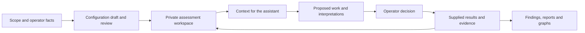

# **Cyber-Operator - AI-Assisted Security Assessment Workspace**

Cyber-Operator helps security teams retain assessment context, organize evidence,
track findings and produce reviewable reports. It connects the work of a human
operator and an external AI assistant through durable records, explicit decisions
and a shared view of assessment progress.

The project addresses a practical problem: observations, rationale and next steps
often become scattered across terminals, conversations and documents.
Cyber-Operator keeps those records connected so work can resume with its scope,
evidence and open questions intact.

**Version:** 0.7.0

**Platform:** Linux / WSL, Python 3.13+

**Full documentation:** [Operator guide and system description](docs/OPERATOR_GUIDE_EN.md)

## **Key Features & Architecture**

- **Human-directed assessment workflow:** Resumable intake, versioned scope and
  policy settings, explicit configuration review and separately recorded activity
  decisions.
- **Durable assessment memory:** Stable IDs, retained revisions, append-only
  journals and consolidated status across assets, objectives, observations,
  activities and findings.
- **Evidence and provenance:** Immutable evidence with hashes, imports of supplied
  scan results and execution receipts linked to the claims they support.
- **Context for an AI assistant:** Bounded briefs that retain relevant constraints,
  identify omitted information and help a new session resume existing work.
- **Finding lifecycle and objective coverage:** Separate confidence, remediation
  and retest states, evidence requirements and explicit limitations for partial
  or untested objectives.
- **Reports and graphs:** Local HTML/JSON report snapshots tied to exact recorded
  state, plus evidence-backed SVG relationship graphs.
- **Continuity and recovery:** Checkpoints, restore, transaction recovery, writer
  leases and optional coordination between sessions under one OS account.
- **Local deployment and data controls:** Independent artifact-handling settings,
  local vault references, reviewed plaintext disclosure, retention holds and
  install/upgrade/verify/rollback tooling.

The implementation separates four responsibilities:

| Component | Responsibility |
| --- | --- |
| **Human operator and reviewer** | Supply engagement facts, define scope, evaluate proposals and record actual decisions |
| **External AI assistant** | Interpret supplied context, develop hypotheses and use available local commands under operator control |
| **Cyber-Operator runtime** | Validate and retain records, preserve integrity, build context and generate reports |
| **External assessment tools** | Perform separately authorized tests and supply results for explicit intake |



The runtime is a collection of local Python tools and `cyber-*` commands.
It works without an AI model; conversational operation requires an external
assistant environment with access to the tools. Version 0.7.0 does not include a
model service, autonomous assessment engine or scanner/exploit executor.

## **Project Structure**

```text
cyber-operator/
|-- AGENTS.md                       # Assistant and development rules
|-- README.md                       # Project overview and quick start
|-- scripts/                        # Python implementation and cyber-* commands
|-- templates/                      # Empty state, reports and assessment presets
|-- tests/                          # Synthetic regression suite
|-- docs/
|   |-- OPERATOR_GUIDE_EN.md        # Standalone English operator guide
|   |-- ARCHITECTURE.md             # Components and integrity contracts
|   |-- MANAGED_WORKFLOW.md         # Configuration and review workflow
|   |-- CURRENT_STATE.md            # Recorded validation results
|   `-- ...                        # Detailed operating and development guidance
|-- knowledge_base/                 # Index for separately reviewed public knowledge
|-- config.example.toml             # Deployment configuration example
|-- pyproject.toml                  # Runtime version and development dependencies
|-- uv.lock                         # Locked development environment
|-- .gitlab-ci.yml                  # GitLab validation pipeline
`-- .github/workflows/ci.yml        # Retained GitHub validation workflow
```

Private workspaces, credentials, evidence, reports and runtime state are stored
outside the repository. They are created explicitly for an assessment and are
not included in the shared source.

## **Available Command Suite**

| Commands | Area | Purpose |
| --- | --- | --- |
| `cyber-init`, `cyber-workspace` | Setup | Preview initialization, create and select private workspaces, run diagnostics |
| `cyber-engagement`, `cyber-decision` | Review | Maintain versioned configuration and record explicit activity decisions |
| `cyber-status`, `cyber-host-state` | Context | Inspect consolidated assessment state and host projections |
| `cyber-host`, `cyber-asset`, `cyber-objective` | Scope model | Register hosts, assets and assessment objectives |
| `cyber-observe`, `cyber-source`, `cyber-scan-import` | Intake | Record observations and import supplied source material or scan results |
| `cyber-activity`, `cyber-provenance` | Work history | Retain supplied work, linked records and execution evidence |
| `cyber-finding`, `cyber-assessment` | Findings | Maintain findings, revisions, reviews and documented relationships |
| `cyber-report`, `cyber-graph` | Reporting | Check readiness and build local report snapshots or SVG graphs |
| `cyber-vault`, `cyber-vault-export`, `cyber-retention` | Private data | Manage local references, separately reviewed disclosure and retention holds |
| `cyber-checkpoint`, `cyber-recovery`, `cyber-stream` | Continuity | Preserve and restore state, recover writes and coordinate sessions |
| `cyber-deploy` | Deployment | Preview and apply local installation, upgrade, verification and rollback |

See the [operator guide](docs/OPERATOR_GUIDE_EN.md) for command examples and the
[capability matrix](docs/CAPABILITIES.md) for managed and legacy workspace behavior.

## **Requirements & Installation**

### System requirements

- **Operating system:** Linux or WSL with the checkout and private data on a Linux
  filesystem.
- **Python:** 3.13 or newer.
- **Development tooling:** `uv`, with dependencies pinned by `uv.lock`.
- **Optional AI interface:** A separately configured assistant that can use the
  local commands.

The runtime uses the Python standard library. Filesystem permissions, locking
and atomic operations are part of its contract, so native Windows Python execution
is unsupported. A Windows checkout can be used for source review and Git transport.

### Installation and setup

Clone this project using its GitLab clone URL into a directory on a Linux
filesystem, then run:

```sh
cd cyber-operator
uv sync --locked
chmod +x scripts/cyber-*
export PATH="$PWD/.venv/bin:$PWD/scripts:$PATH"
mkdir -p -m 700 "$HOME/.local/share/cyber-operator/workspaces"
cyber-workspace list
```

An empty list is expected on a new installation. No active workspace, target,
credential or authorization is shipped.

Deployment paths can be configured through
[config.example.toml](config.example.toml), `CYBER_CONFIG`,
`CYBER_WORKSPACE_ROOT` and supported command options. For an installed runtime,
see [Deployment](docs/DEPLOYMENT.md).

## **Usage**

### Start an assessment

Collect the fields in [Operator intake](docs/OPERATOR_INTAKE.md) and save the
reviewed intake JSON outside the checkout. Preview initialization before applying
the same reviewed input:

```sh
# Replace the input path and workspace name with your reviewed values.
cyber-init --root "$HOME/.local/share/cyber-operator/workspaces" --template pentest-web-app-standard --input /private/intake.json
cyber-init --root "$HOME/.local/share/cyber-operator/workspaces" --template pentest-web-app-standard --input /private/intake.json --apply
cyber-workspace select --module example-review
cyber-workspace select --module example-review --apply
cyber-workspace doctor --json
cyber-engagement status
cyber-engagement questions
cyber-status
```

Initialization can create an incomplete draft. Complete the missing answers,
preview the complete definition, submit it and record the reviewer's explicit
decision through the [managed workflow](docs/MANAGED_WORKFLOW.md). Workspace
selection does not replace configuration review or authorize target actions.

### Example assistant requests

These examples assume an external assistant with local tool access:

> **Assessment setup:** Help me prepare a workspace. Collect the missing scope,
> timing and data-handling facts, then show me the configuration preview.

> **Session resumption:** Read the current status and bounded context. Summarize
> confirmed findings, unresolved hypotheses, missing evidence and open decisions.

> **Evidence review:** Link this supplied observation to the relevant asset and
> objective. Identify which conclusions it supports and which need further evidence.

> **Reporting:** Check report readiness, explain uncovered objectives and prepare
> an HTML/JSON report preview from the reviewed records.

## **Structured Information Model**

| Record | What it retains |
| --- | --- |
| Engagement | Scope, objectives, time window, policy choices, setting origins and review history |
| Asset and objective | Applications, endpoints, services or identities, with explicit scope and coverage references |
| Evidence | Retained bytes, provenance, metadata and content hashes |
| Finding | Confidence, severity, impact, evidence, remediation and retest state |
| Activity and decision | Supplied work and outcomes, linked records and actual human decisions |
| Relationship | An observed, inferred or rejected connection between assets and findings |
| Report snapshot | The configuration, record revisions and journal sequence used to produce a deliverable |

Corrections create new revisions while preserving prior state. Confirmed findings
and retests require evidence; reports expose incomplete coverage and unresolved
checks. See [Findings and reporting](docs/FINDINGS_REPORTING.md).

## **Output Reports & Graphs**

- **Readiness checks** evaluate objective coverage, finding reviews, evidence
  requirements and unresolved token state.
- **HTML reports and schema-3.0 JSON snapshots** bind the output to reviewed
  configuration and exact recorded state.
- **Unresolved checks** produce an explicitly marked draft rather than a ready
  report.
- **SVG graphs** present documented relationships and retained operational paths.
  Observed relationships require evidence references.
- **Preview/apply publication** retains existing outputs and uses recoverable
  writes. Ordinary reports exclude secret values.

PDF/DOCX report adapters and remote rendering services are not part of this
release. The operator guide is available separately in Markdown and PDF formats.

## **Security & Operating Boundaries**

- **Explicit operator control:** Templates, loaded context, restored history and
  configuration acceptance do not authorize target actions.
- **Independent storage choices:** `standard` and `no-download` govern supported
  local persistence of target-origin files. Remote storage `disabled`/`approved`
  records location metadata and performs no transfer.
- **Preserved integrity:** Supported writes use validation, append-only histories,
  immutable evidence, private permissions, locks, transactions and stale-state checks.
- **Untrusted inputs:** Imported material and model output require review; a model
  interpretation does not itself establish a finding.
- **Local identity limits:** Actor labels and review receipts are audit records,
  not authentication or central RBAC. Independent operators need separately
  protected runtimes.
- **External-tool limits:** The runtime does not supervise arbitrary commands or
  automatically control the network behavior of external assessment tools.

See [Security and privacy](docs/SECURITY_AND_PRIVACY.md),
[Artifact handling](docs/ARTIFACT_HANDLING.md) and [Local vault](docs/LOCAL_VAULT.md)
for the detailed contracts.

## **Documentation & Validation**

Start with the **[English operator guide](docs/OPERATOR_GUIDE_EN.md)** for
architecture, conversational setup, workflows, command references and diagrams.

**[Download the English operator guide (PDF)](docs/pdf/Cyber-Operator_Operator_Guide_EN.pdf)** for Cyber-Operator **0.7.0**, added on **2026-10-14**. This is the review-draft edition dated 2026-10-13.

Additional references:

- [Architecture](docs/ARCHITECTURE.md)
- [Managed workflow](docs/MANAGED_WORKFLOW.md)
- [Activity and context](docs/ACTIVITY_AND_CONTEXT.md)
- [Findings and reporting](docs/FINDINGS_REPORTING.md)
- [GitLab handoff](docs/GITLAB_HANDOFF.md)
- [Current verification](docs/CURRENT_STATE.md)
- [Changelog](CHANGELOG.md)

Run development checks on a Linux filesystem:

```sh
uv sync --locked
uv run --locked python -m pytest -q
uv run --locked ruff check .
uv run --locked python scripts/release_check.py
```

Tests use temporary synthetic workspaces. The GitLab pipeline runs the complete
suite, Ruff and the release-content validator on a Linux container runner.
Local validation results are recorded in
[Current verification](docs/CURRENT_STATE.md); GitLab reports remote pipeline
results separately.
