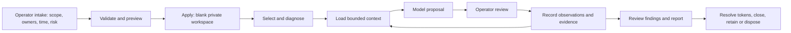

# Cyber-Operator

Cyber-Operator helps a security team preserve context, assessment records, evidence
and reporting continuity. The operator supplies scope and makes decisions; a model
can review bounded context and propose work. Loading a workspace never authorizes
actions against a target.

The runtime is a collection of local Python tools, shell entry points and agent
instructions. It does not contain a model service, autonomous assessment engine,
remote file-transfer service or multi-user identity provider.

## Start

Use Python 3.13+ on Linux or WSL, with the project and private data on a Linux
filesystem. Windows-native execution is unsupported because locking and private
filesystem permissions are part of the runtime contract.

```sh
uv sync --locked
export PATH="$PWD/.venv/bin:$PWD/scripts:$PATH"
mkdir -p -m 700 "$HOME/.local/share/cyber-operator/workspaces"
cyber-workspace list
```

An empty list is expected in a new installation. No active workspace, host, secret,
authorization or writer lease is shipped.

Collect the fields in [Operator intake](docs/OPERATOR_INTAKE.md), store the reviewed
JSON outside this repository, and initialize it through `cyber-init`. Partial facts
create a draft with missing-field questions. Preview and
apply are separate calls. Selection remains a separate decision.

```sh
cyber-init --root "$HOME/.local/share/cyber-operator/workspaces" --template pentest-web-app-standard --input /private/intake.json
cyber-init --root "$HOME/.local/share/cyber-operator/workspaces" --template pentest-web-app-standard --input /private/intake.json --apply
cyber-workspace select --module client-review
cyber-workspace select --module client-review --apply
cyber-workspace doctor --json
cyber-workspace resolve --check-write
```

Replace `/private/intake.json` and `client-review` with the reviewed file and its
workspace name. `--root`, the `CYBER_WORKSPACE_ROOT` environment variable and the
optional `CYBER_CONFIG` TOML file support deployment-specific paths. See
[config.example.toml](config.example.toml). Never place client data in this checkout.

## Policies

New team workspaces use [versioned assessment configuration](docs/CONFIGURATION.md).
`engagement.json` is authoritative; every proposal and review is tracked in
`engagement_events.jsonl`. `TASK_CONTEXT.md` is a generated view. Select
`standard-assessment` or `pentest-web-app-standard`; templates supply reviewable
defaults and policy boundaries, not permissions. The web template prohibits shells,
persistence and expansion beyond explicitly scoped applications/APIs.

Use `cyber-engagement status`, `questions`, `show` and `history` to inspect the
configuration. Changes use previewed `propose` and `approve` decisions with revision
and event-sequence checks. Pending proposals leave effective settings unchanged.
`reject`, `pause` and `revoke` preserve the decision history. See the configuration
guide for the complete workflow, compatibility and implementation limits.

An external scope/RoE document is optional: explicitly answer `None` to record no
document. Omitted answers remain visible as missing facts. Explicit configuration
reviews can use an internal audit receipt instead of an external document reference.
Scope, timing and individual policy choices still require review; see
[Operator intake](docs/OPERATOR_INTAKE.md#optional-external-documentation).

| Choice | Effect |
|---|---|
| Legacy `strict` / `controlled-engagement` | Unmanaged-workspace compatibility; managed workspaces configure the report contract explicitly. |
| `standard` | Local target-file persistence is subject to the engagement's data approval. |
| `no-download` | Supported intake refuses local persistence of target-origin files. |
| Remote storage `disabled` | No remote artifact location is registered. |
| Remote storage `approved` | Records the approved URI and approval reference. Performs no transfer. |

The storage switches are independent. `no-download` never selects a host, enables
remote storage or relaxes secret handling. Read [Artifact handling](docs/ARTIFACT_HANDLING.md)
for enforcement boundaries and operator responsibilities.

In managed workspaces, supported target-file capture also requires current
configuration review within the assessment window. Legacy setters and target-grant
commands cannot override the new model. Configuration review records accepted
conditions; it does not grant permission for target actions.

## Workflow and structure



See [Architecture and logical tree](docs/ARCHITECTURE.md),
[Operator workflow](docs/OPERATOR_WORKFLOWS.md),
[Reporting](docs/REPORTING.md), [Security and privacy](docs/SECURITY_AND_PRIVACY.md),
[Team use](docs/TEAM_WORKFLOW.md) and [Release notes](CHANGELOG.md).

## Verification

```sh
uv run python -m pytest -q
uv run ruff check .
uv run python scripts/release_check.py
```

Tests create synthetic temporary workspaces. They do not run a live assessment.
The observed validation results are recorded in [Current state](docs/CURRENT_STATE.md).
