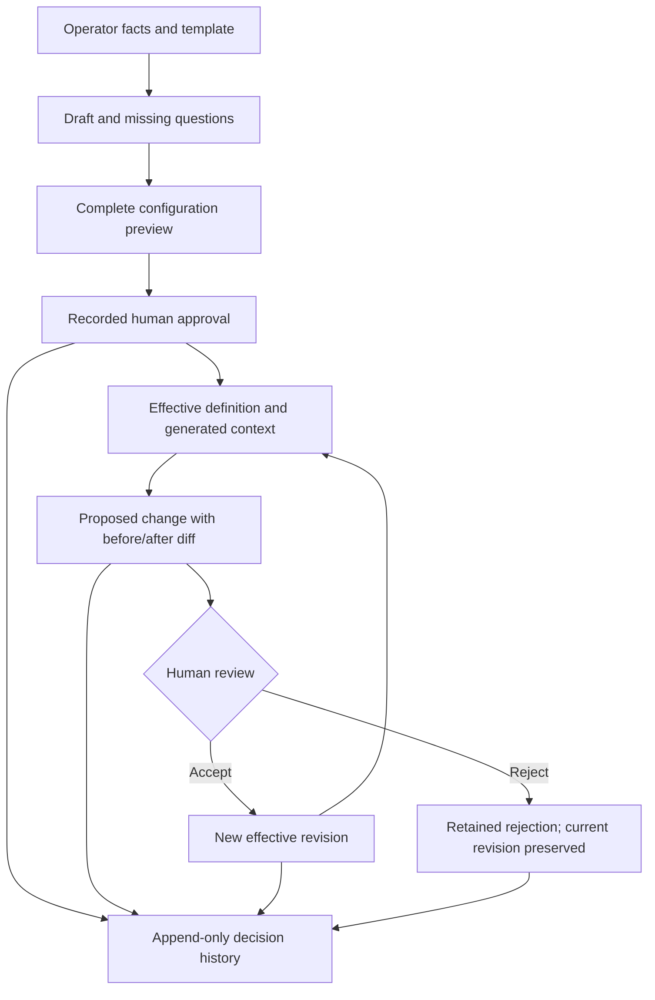

# Versioned assessment configuration

Cyber-Operator 0.3.1 unifies intake, template defaults and configuration review.
The model stores assessment governance and evidence requirements. It is not a
target-action executor, permission-granting engine or network scope filter.

## Authority and files

| File | Responsibility |
|---|---|
| `engagement.json` | Current definition, schema 1.0, stable engagement ID and integer revision |
| `engagement_events.jsonl` | Append-only creation, proposal, approval, rejection, pause and revocation events |
| `TASK_CONTEXT.md` | Generated, validated projection for the operator and assistant |
| `private/transactions/` | Existing durable journal used for recoverable multi-file publication |

History contains full configuration snapshots for creation/proposals/approvals,
before/after diffs including setting origins, actor, UTC timestamp, reason, approval
reference, sequence and SHA256 chain. Snapshots and generated context must agree with
committed history. Supported readers fail closed on unexpected edits, missing
components, invalid schemas or unfinished transactions.

Mutations require both the expected effective revision and latest event sequence.
This detects another proposal, review, pause or revocation even when the effective
revision has not changed. The workspace writer guard serializes cooperating writers
and preserves existing stream-lease fencing. Only an accepted proposal advances the
effective revision; each decision advances the event sequence. Rejected and
superseded proposals remain auditable and cannot override a newer configuration.

## Template snapshots

Templates live in `templates/assessment-profiles/`. Their IDs, versions and policy
values are materialized in the draft. Existing definitions are never reinterpreted
by reading an updated template file.

- `standard-assessment@1.0.0`: general explicit scope and evidence governance.
- `pentest-web-app-standard@1.0.0`: explicitly listed HTTP(S) applications/APIs,
  minimum sufficient evidence, stop after confirmation and fixed prohibitions.

The web template excludes interactive shells, persistence, credential collection,
lateral movement, host exploration, availability testing, bulk data collection,
unlisted services and unapproved third-party testing. Any RCE validation requires
explicit human review and minimum sufficient evidence, followed by a stop.
Configuration approval alone does not permit it. The template supplies no payloads,
automatic validation steps or automatic technique progression.

Web scope accepts explicit credential-free application URLs, including specified
non-default ports. Bare IP inventories and wildcard application URLs are refused.
A shared IP, redirect, API discovery or host-card entry does not extend scope.
Exact include/exclude duplicates are rejected. Semantic ambiguity, aliases and
third-party identity flows still require human review; this is not traffic filtering.

Each mutable setting has an origin: `template`, `operator-preference` or
`engagement-restriction`, with a reference. Restriction origins cannot be downgraded
to preferences through the change interface. Changing their values requires review.
Template identity and policy prohibitions remain fixed within an engagement; a
different policy family requires a separately reviewed definition/workspace.

Maximum operational impact is separate from finding severity. Reporting requirements
are explicit instead of being inferred from the operational profile. The web template
requires the `engagement` report contract; an ad hoc CLI override is refused.
Report-manifest schema 2.0 and its existing objective structure remain unchanged.

## Conversation and draft creation

The external assistant collects missing facts in small groups, reuses supplied
information and presents template defaults for review. It asks about scope, owners,
objectives, timezone-aware dates, impact, stop conditions, data and reporting.
Ask "Are target file downloads permitted for this assessment?" and retain the
answer's basis. Remote storage and callback metadata are separate questions.
Never infer customer approval from a default or invent an approver's decision.

External scope/RoE documentation is optional. Explicit JSON `null` or a `None`/`null`
string at the facts/proposal boundary means no external document; strings are
case-insensitive and are normalized to JSON null. The `scope_reference` origin
distinguishes that answer from an unanswered template null. Status exposes
`scope_reference_state`: `unanswered`, `no-external-document`, or `provided`.
Only the unanswered state prompts again. Empty strings and non-text values other
than null are invalid. This distinction uses the existing schema-1.0 origins and
does not rewrite historical definitions, event hashes or generated context.

Prepare a private facts file; this partial example contains only synthetic data:

```json
{
  "name": "application-review",
  "team_id": "TEAM-001",
  "operator_id": "OP-001",
  "reviewer_id": "RV-001",
  "scope_reference": "ROE-001",
  "in_scope": ["https://app.example.test/"],
  "excluded": ["Unlisted applications and third-party services"],
  "objectives": ["Review the application within its approved boundaries"],
  "artifact_handling": "no-download"
}
```

The collection must already exist as a private directory outside the repository.

```sh
cyber-init --root /private/workspaces --template pentest-web-app-standard --input /private/facts.json
cyber-init --root /private/workspaces --template pentest-web-app-standard --input /private/facts.json --apply
cyber-engagement questions --workspace /private/workspaces/application-review
cyber-engagement status --workspace /private/workspaces/application-review
```

This creates a draft with questions for the missing dates. Preview creates nothing;
apply atomically publishes a blank workspace, revision 1 and the first history event.
No host, active selection or configuration approval is created. `cyber-engagement
draft` can also emit the full definition for inspection, including setting origins.
For restrictions from approved conditions, set the corresponding origin to
`engagement-restriction` and reference that document, or submit a proposal with that
basis. Initial facts otherwise record a declared operator preference pending review.

## Changing an answer

For "Allow local target-file downloads under CHANGE-001", prepare this change file:

```json
{"artifact_handling": "standard"}
```

Read status first. For an approved revision 1 whose latest event is 2:

```sh
cyber-engagement propose --workspace /private/workspaces/application-review \
  --input /private/change.json --actor OP-001 --reason "Reviewed data handling change" \
  --basis engagement-restriction --basis-reference CHANGE-001 \
  --expected-revision 1 --expected-event 2
```

Review the diff, then apply the same proposal with `--apply`. Event 3 is retained;
the effective download restriction remains unchanged. The configured reviewer then
previews approval of that exact proposal:

```sh
cyber-engagement approve --workspace /private/workspaces/application-review \
  --proposal-sequence 3 --actor RV-001 --reason "Accepted revised data handling" \
  --approval-reference CHANGE-001 --expected-revision 1 --expected-event 3
```

Apply the reviewed decision with `--apply`. The definition becomes revision 2 and
the decision becomes event 4. Approval takes effect from that decision onward;
it is not retroactive and initiates no file transfer. Initial approval uses the
same interface without `--proposal-sequence`, after all required facts are complete.

An external approval reference is also optional. Omitting `--approval-reference`,
or passing None, creates a local receipt `local-review:<engagement-id>:<event-sequence>`.
The explicit approve operation still requires the configured reviewer, a reason,
complete facts, a valid window and fresh revision/event checks. Preview and apply
return the same receipt for the same event sequence. Existing external references
are preserved. A local receipt traces the recorded decision; it is not an external
authorization document. Providing no document does not expand scope, change impact,
enable downloads or callbacks, or grant target-action permission.

The reviewer may also be the operator if that is the configured team procedure.
There is no mandatory second person. IDs and references are declarations, not SSO
or authenticated signatures. The assistant must not assume another person's consent.

## Lifecycle and decisions

| State | Meaning |
|---|---|
| `draft` | Required intake facts are missing |
| `ready-for-review` | Complete but unreviewed, or fresh review required after restore/reopen |
| `scheduled` | Reviewed configuration whose time window has not started |
| `active` | Current reviewed configuration within its time window |
| `paused` | Explicit pause or revocation |
| `expired` | The assessment window has ended |
| `closed` | Existing workspace lifecycle has closed the assessment |

`active` describes configuration status, not target-action permission. Reviews bind
the exact snapshot, revision, workspace instance and lifecycle epoch. Restore and
close/reopen invalidate previous reviews. Pause/revocation require fresh approval.
Local review of existing documentation remains available. Deadlines are evaluated
on supported calls; no background service kills tools or deletes retained files.

`cyber-engagement` offers `templates`, `draft`, `show`, `questions`, `status`,
`history`, `propose`, `approve`, `reject`, `pause`, `revoke` and `adopt`. Mutations
preview by default. Approval requires the configured reviewer's ID and a non-empty
reference. Pause, revocation and rejection require a configured operator or reviewer.
Reapproval of the current revision resumes it, subject to time and lifecycle checks.



## Storage and compatibility boundaries

Local downloads and remote storage remain independent; all four combinations are
valid. Remote registration requires a credential-free location and approval reference.
It never selects a host or transfers files. Callback addresses and ports are separate
metadata, not permission for a connection, storage registration or scope extension.

Supported file intake reads the canonical definition. `no-download` refuses target
files before the capture helper reads their bytes. With `standard`, that helper also
requires current configuration review within the assessment window. Draft, scheduled,
paused, expired, restored-unreviewed and closed configurations cannot use that route
to persist target files. Operator-created evidence retains separate provenance rules.

Legacy profile, artifact and remote-storage setters are blocked for managed
workspaces. Editing Markdown cannot change policy. Legacy standing/exact target
authorization grants are also unavailable there: their category-based records do
not express the new application scope and template boundaries. Historical records
remain readable. Configuration review does not silently recreate such grants.
Secret display dependent on a legacy standing grant consequently remains unavailable
in a managed workspace. Low-level `cyber-workspace init` remains a legacy interface;
new team assessments should use `cyber-init`.

## Migration and recovery

Old workspaces are not migrated on read. Prepare a reviewed revision-1 definition
using the existing workspace name and storage choices, then preview `cyber-engagement
adopt --workspace ... --input ... --actor ... --reason ...`. Apply also requires
`--expected-context-sha256` with the hash returned by preview. Existing intake facts
are checked for conflicts; differences are refused instead of silently choosing a
winner. The desired report contract is explicit in the proposed definition.

Adoption preserves old ledgers and any historical intake file. It installs the new
authority as an unapproved draft using the transaction journal, without importing
historical approvals. Review scope and privacy settings, especially where the legacy
workspace lacked complete metadata.

Commits append an event and publish its snapshot/context through a typed
`engagement-config` transaction. A crash may leave a prepared transaction; readers
refuse to present mixed state as valid. Use `cyber-recovery inspect` and the existing
reviewed recovery procedure. Recovery replays retained bytes, verifies the prepared
event/snapshot/context relationship and does not invent approvals.

## Trust and current limits

SHA256 chains expose inconsistent edits; they are not signatures or protection
against an OS-account owner who can rewrite all files and recompute hashes.
Approver IDs and references are not authenticated organizational authorization.
Store no secrets in configuration text, URLs, callbacks or approval references.

The conversation runs in the existing assistant; no embedded model service is added.
Web restrictions are retained policy instructions and validation boundaries, not
interception of arbitrary shell commands or third-party tools. Scope semantics,
actual reviewer identity and Rules of Engagement approval remain team responsibilities.

Retention is recorded, not automatic deletion. Per-artifact or temporary download
exceptions are not implemented; use an appropriately reviewed configuration revision.
Directly restoring an old definition is not supported rollback: propose the desired
values as a new revision to preserve history. The report manifest remains a separate
reporting contract; this release does not redesign findings or objective storage.
