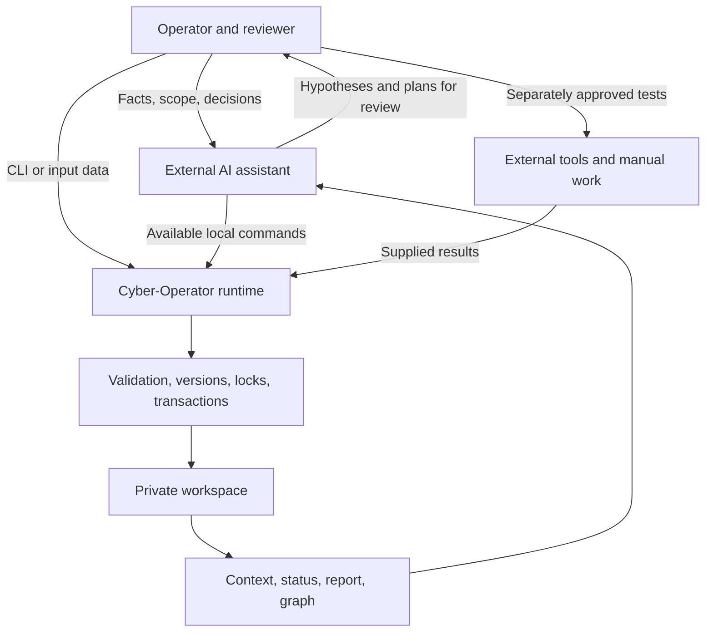
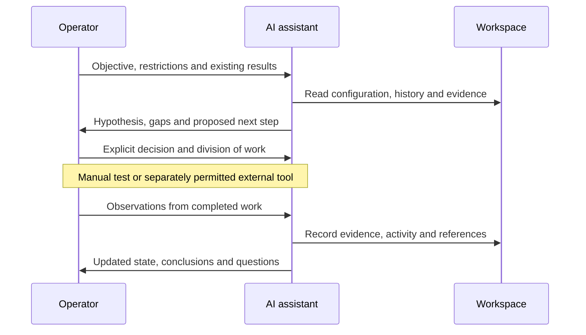
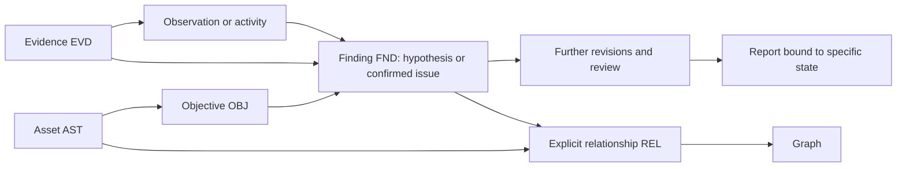
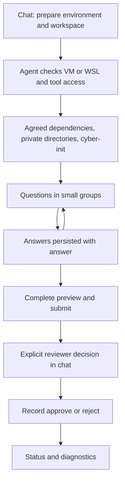
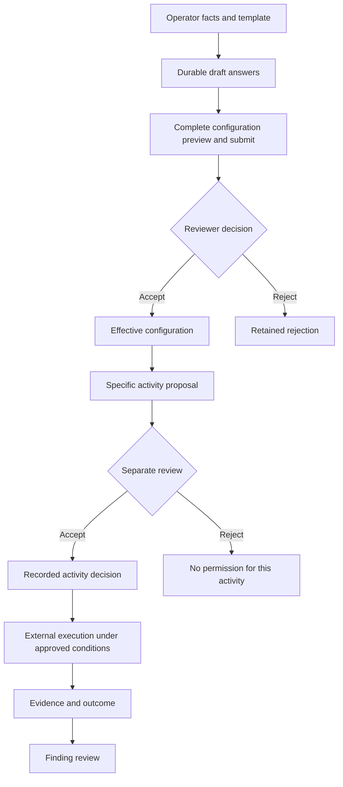
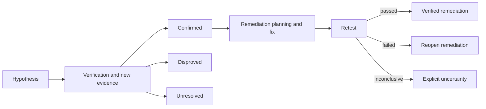
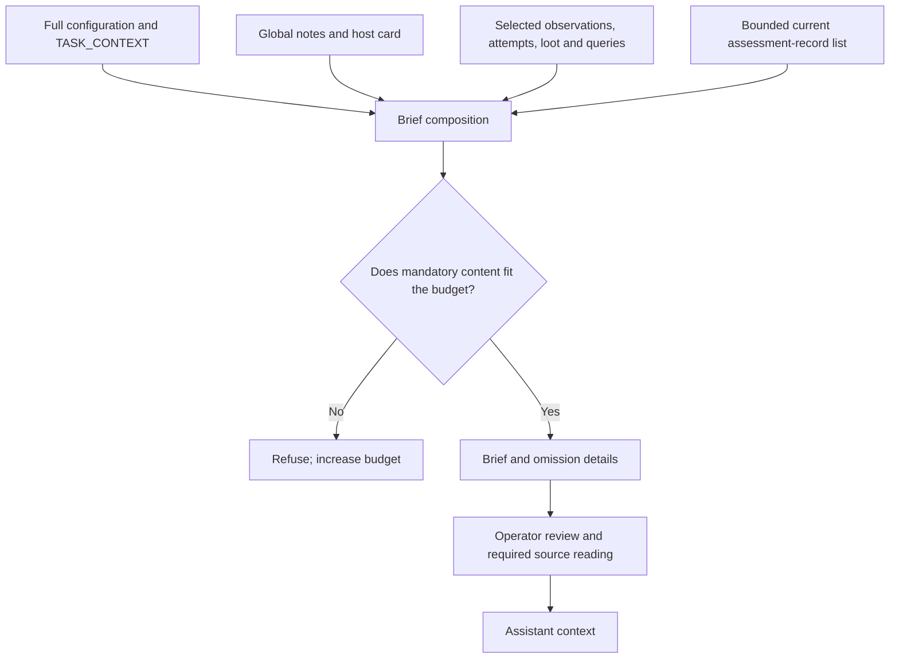
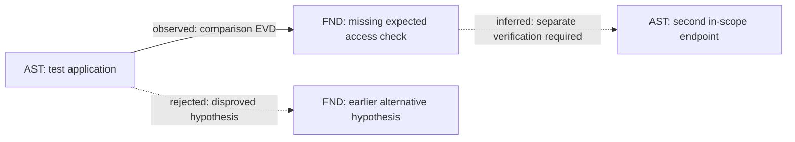
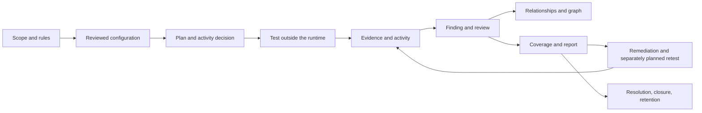
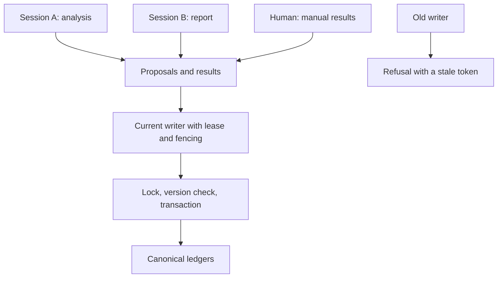

# Cyber-Operator - operator guide and system description

**Review draft, 13 October 2026.** This guide describes Cyber-Operator **0.7.0**, reviewed against source revision `00ebb3e`. It combines operating instructions with an explanation of the internal mechanisms. All examples are synthetic: they describe no actual engagement and grant no permission to test systems.

Diagrams are embedded in Markdown as Mermaid. A Mermaid-compatible viewer is required to display them as graphics. Process diagrams explain the workflow; an actual graph exported from a workspace is a separate SVG file.


## Contents

1. [Purpose of the agent](#purpose)
2. [Architecture and responsibilities](#architecture)
3. [Operation and collaboration modes](#operation)
4. [Memory and information model](#memory)
5. [Starting a new workspace](#start)
6. [Settings, switches and their purpose](#settings)
7. [Configuration reviews and activity decisions](#decisions)
8. [Information intake, hypotheses and next steps](#hypotheses)
9. [Building context for the model](#context)
10. [Attack graph: construction and interpretation](#graph)
11. [Example penetration-testing workflow](#pentest)
12. [Safeguards and their limits](#safeguards)
13. [Credentials, tokens and retention](#secrets)
14. [Reporting and objective coverage](#reporting)
15. [Parallel work, resumption and recovery](#continuity)
16. [Command map and troubleshooting](#commands)
17. [Limitations and possible improvements](#development)
18. [Glossary, code references and validation](#sources)

<a id="purpose"></a>
## 1. Purpose of the agent

Cyber-Operator helps a team conduct an organized security assessment: retain scope and working rules, collect observations, preserve evidence, track hypotheses and findings, record decisions and prepare reports. It reduces situations where a result exists only in one person's terminal, its rationale only in a conversation, and the next session has to reconstruct progress from memory.

In conversation, **the agent** may mean the whole combination of an AI assistant, repository instructions, local tools and a private workspace. The implementation separates these components:

- **The AI model/assistant** interprets supplied information, forms hypotheses, proposes steps and may call available tools according to operator decisions.
- **The Cyber-Operator runtime** consists of local Python scripts, `cyber-*` commands, templates and validators. It stores, checks and processes supplied records.
- **The human** supplies engagement facts, evaluates proposals, records actual approvals and remains responsible for the real scope of work.
- **External tools** perform any target testing. They are not an execution engine built into this product.

**Version 0.7.0 contains no model service, autonomous pentester, attack scheduler or scanner/exploit executor.** It also has no automatic remote file transfer. `cyber-scan-import` imports results, `cyber-provenance record` retains a supplied execution receipt, and `cyber-activity` records a supplied account of work. These names do not mean a test was executed.

The agent can therefore serve as memory and analytical assistance while a human performs every test manually. It can also support an assistant with separate execution tools. In that case, approvals, restrictions and execution controls must cover those tools as well.

### 1.1. Reasoning models and local-model operation

Cyber-Operator was designed for collaboration with models capable of deep, multi-step reasoning, such as suitable **GPT models from OpenAI** and **Claude models from Anthropic**. They help connect evidence, assess alternative explanations, plan work and maintain constraints across longer tasks. This is the project's intended operating model, not a claim of a built-in provider connection or certified compatibility with every model in either family.

Model tool use involves proposing calls that an application or assistant environment executes. See [OpenAI: Function calling](https://developers.openai.com/api/docs/guides/function-calling) and [Anthropic: How tool use works](https://platform.claude.com/docs/en/agents-and-tools/tool-use/how-tool-use-works). Cyber-Operator supplies local commands; the layer connecting them to a model sits outside the runtime.

**A sufficiently capable local large language model could potentially support part or all of the existing workflow.** This is an architectural inference from the separation between models and tools, not a demonstrated project benchmark. “All” means the existing information-management, analysis, review and reporting workflow; it does not add an autonomous pentester. Local model servers can expose tool calling, as documented in [Ollama: Tool calling](https://docs.ollama.com/capabilities/tool-calling), but a model server does not automatically integrate Cyber-Operator commands.

| Option | Potential result | Requirements |
| --- | --- | --- |
| Local model without tool access | Analysis of a supplied brief, proposals and drafts; the human performs writes | Manual exchange of context/results and review of proposals |
| Local model with a tool layer | Potentially complete conversational operation of the existing CLI | Adapter or agent host, correct arguments, result/error/counter handling and review procedure |
| External GPT/Claude model with tools | The same collaborative workflow with strong reasoning support | VM/WSL access, an appropriate model and permissions, and agreed data-sharing rules |

Suitability depends on reasoning, instruction following, valid JSON generation, tool/error handling, context capacity and distinguishing facts from hypotheses, not only model size. A smaller model may organize records well while needing more help with complex relationships. A local model does not guarantee zero disclosure: check the chat application, logs, telemetry and network tools too.

Before adopting another model, run a synthetic evaluation covering saved-answer resumption, stale-counter refusal, the download restriction, refusal to invent approval, correct EVD-to-finding links and brief omissions. The repository defines no certified minimum local-model size or GPU-memory requirement.

<a id="architecture"></a>
## 2. Architecture and responsibilities



The arrow carrying results into the runtime means **explicit import or recording**. The product does not automatically watch terminals, browsers or conversations, or detect when a human finishes a task.

| Layer | What it does | What it does not establish by itself |
| --- | --- | --- |
| `AGENTS.md` instructions | Define assistant behavior and repository rules | Not an operating-system block on arbitrary commands |
| Configuration | Retains scope, time, restrictions, setting origins and review | Not permission for every possible in-scope activity |
| Decision records | Bind a specific proposal to a recorded human review | Do not authenticate the person entering an actor ID |
| Records and evidence | Validate structure, references, integrity and history | Do not independently determine whether a narrative is true |
| AI assistant | Connects facts and proposes interpretations and further work | Its output is not automatically evidence of a target condition |
| Report and graph | Present retained state and relationships | Do not prove that unrecorded tests occurred |

Ordinary runtime operation uses the Python standard library; the development environment adds testing tools. Supported execution requires **Linux or WSL, Python 3.13+ and a Linux filesystem**. Permissions, locking and atomic operations are part of the application contract, so native Windows Python execution is not a supported deployment.

<a id="operation"></a>
## 3. Operation and collaboration modes

### 3.1. Human-supplied data, agent-assisted organization

The operator describes an observation, supplies an allowed tool result or references existing evidence. The assistant prepares the appropriate record, explains it and stores it through the relevant command. It can then compare the result with previous observations, propose a hypothesis and identify missing information.

For example: “I compared two test accounts. Their responses differ, but I do not yet know whether permissions or different inputs explain the result.” The appropriate record is an observation and a hypothesis requiring verification, not an automatically confirmed vulnerability.

### 3.2. Human and assistant perform different parts of the work

The operator may explore application behavior manually while the assistant organizes supplied results, updates objective coverage, drafts a report or prepares questions. Both contribute results to the same information model.

If an external assistant can execute an approved test, its result still requires intake and correct provenance. A planned command alone is insufficient to record it as executed. There is no built-in “run the full pentest automatically” mode.



### 3.3. Operation without a model

Commands work without an AI conversation. The operator prepares JSON, previews the operation, checks the result and applies it. These are the same mechanisms an assistant can use. Conversation is a collaboration interface; it does not replace durable records.

**Chat-based operation also covers environment preparation and workspace creation.** With terminal and file access in the designated VM/WSL environment, the assistant can check dependencies, carry out an agreed installation, prepare input files and invoke the CLI. The human can supply facts in ordinary language rather than writing JSON or copying commands. Without environment access, chat can only provide instructions. Section 5.7 shows a sample conversation and review points.

### 3.4. Multiple sessions and people

Several assistant sessions under one OS account can use optional `cyber-stream` coordination. One canonical writer is retained. This prevents conflicting writes; it is not a team server with authentication and roles. Independent operators should have separately protected runtimes, with handoff governed by team procedure.

<a id="memory"></a>
## 4. Memory and information model

Product memory consists of **files and versioned ledgers in a private workspace**, not hidden model memory. A new session resumes by reading these records. The system contains no vector database, automatic RAG or model training on engagement history.

### 4.1. Main entities

| Entity | Meaning | Important relationship |
| --- | --- | --- |
| Engagement, `ENG-*` | Engagement definition and settings | Has its own revision and review history |
| Host, `H01`, etc. | Stable host identity, names and interfaces | Friendly names can change without rewriting evidence |
| Asset, `AST-*` | Application, endpoint, service, host or identity | References explicit scope; may link hosts and parents |
| Objective, `OBJ-*` | Assessment objective | Its title comes from configuration; references assets |
| Observation | Structured observation | Links host, source and optional evidence; has a separate state |
| Evidence, `EVD-*` | Retained bytes, metadata and SHA-256 | Separate from interpretation of the result |
| Finding, `FND-*` | Hypothesis or finding | Links assets, objectives, evidence, remediation and retest status |
| Relationship, `REL-*` | Directed asset/finding relationship | State is `observed`, `inferred` or `rejected` |
| Decision, `DEC-*` | Specific activity proposal and decision | Bound to configuration, workspace instance and lifecycle |
| Activity, `ACT-*` | Supplied description of work and result | Links records; may create an attempt, task or finding |
| Attempt, `ATT-*` | Attempt outcome and recorded next step | May have a structured identity for duplicate detection |
| Run and claim | Execution receipt and atomic assertion | Separate a declaration from supporting artifacts |
| Query and AI session | Explicit query record and session metadata | Not an automatic transcript of every conversation |

Managed `AST-*`, `OBJ-*`, `FND-*`, `REL-*`, `DEC-*` and `ACT-*` identifiers have UUID suffixes. Short diagram labels are illustrative, not valid identifiers to paste into real records.

### 4.2. Information locations

```text
Product repository/
  scripts/                      implementation and commands
  templates/                    empty templates and policies
  tests/                        synthetic tests
  docs/                         documentation
  knowledge_base/               public general knowledge, no engagement data

Private collection outside the repository/
  ACTIVE_TASK                   explicitly selected workspace
  demo-web/
    engagement.json             effective configuration definition
    engagement_events.jsonl     draft answers, proposals and configuration decisions
    assessment_events.jsonl     versioned assets, objectives, findings and activities
    TASK_CONTEXT.md             generated settings and paths
    global.md                   notes and global state projection
    hosts/                      host cards
    observations.jsonl          observations
    attempts.jsonl              attempts, outcomes and next steps
    loot.jsonl                  historical discovery record type
    evidence/                   immutable artifacts and metadata
    queries/                    explicitly retained queries
    inbox/                      material awaiting intake
    report/                     reports, snapshots, graphs and notes
    private/                    secrets, coordination and transaction data
```

This is a responsibility map, not an exhaustive file inventory. Some directories and ledgers are created only when used. New findings and reports do not require artificial `loot.jsonl` entries.

### 4.3. How information is tracked logically

Each new assessment entity receives an ID. A correction creates **another revision of the same ID**. `assessment_events.jsonl` retains previous versions; current state is reconstructed by taking the latest version of each entity from history.

An event includes the actor, reason, UTC time, entity type, entity revision, configuration reference and previous-event hash. Validation checks number/hash continuity, referenced entities and type-specific rules. Host cards and global state are projections, not alternative authorities.



Arrows show information dependencies. They do not mean the runtime creates findings or relationships automatically when an observation is stored. Those operations require explicit input.

### 4.4. Identifiers: TXN, EVD, LOOT and others

An identifier is a stable logical address for an entity or event. Instead of copying an entire result into every note, a record references `EVD-*`, allowing the system to locate and check the corresponding evidence. A prefix says **what kind of object it is**, not how important or trustworthy it is.

| Prefix | Identifies | Logical role |
| --- | --- | --- |
| `TXN-*` | Local write transaction | Links plan, operations and receipt; supports interrupted-write recovery. Not a target test |
| `EVD-*` | Evidence and metadata | References retained bytes, size, SHA-256, host and intake time |
| `LOOT-*` | Historical `loot.jsonl` record | Describes a categorized discovery and evidence references; does not imply automatic collection or compromise |
| `OBS-*` | Observation | Links host, source, data type, state and evidence |
| `ATT-*` | Attempt record | Retains result, references and next step; may support deduplication |
| `ENG-*` | Engagement | Common identity across configuration revisions |
| `AST-*`, `OBJ-*` | Asset and objective | Bind results to an explicit part of scope and assessment question |
| `FND-*` | Finding | Stable hypothesis/finding identity across corrections, remediation and retests |
| `REL-*` | Relationship | Identifies one documented graph edge |
| `DEC-*` | Activity decision | References an exact proposal, its review and possible revocation |
| `ACT-*` | Activity | Connects a supplied work narrative with other records |
| `AUTH-*` | Authorization record or decision compatibility receipt | Used by older recorders; an existing ID does not establish current permission |
| `RUN-*`, `CLM-*` | Execution receipt and claim | Link a supplied execution account to an atomic assertion and artifacts |
| `QRY-*`, `AIS-*` | Query and AI-session metadata | Identify context/model and related decisions without automatic chat capture |
| `CRED-*`, `SEC-*` | Credential and vault value | Separate credential metadata from the secret; references use `vault:SEC-*` |
| `TOK-*`, `TKE-*` | Token and token-lifecycle event | Separate token identity from its event history |
| `CHG-*`, `CHGE-*` | Operational change and change event | Track one change, its state and resolution |
| `PTH-*` | Operational path event | Links transition, outcome, attempt, evidence and authorization basis |
| `WKI-*`, `WIE-*` | Work item and work-item event | Retain ownership, progress and review |
| `LAR-*`, `LAE-*` | Local processing artifact and event | Track an allowed file and its usage/retention; do not override `no-download` |
| `RPT-*`, `CHK-*` | Report snapshot and checkpoint | Identify a retained report state or recovery copy |
| `RET-*`, `DSC-*` | Retention and disclosure model records | Retain data-retention and disclosure decisions |

Two main formats are used: a prefix plus UUID, such as TXN and managed assessment records, and a prefix plus UTC timestamp, such as `EVD-20261013T120000000001Z`. This is a synthetic syntax example, not an existing evidence record. Historical findings also use `FND`, but with time-based suffixes; managed findings use UUIDs. Do not alter or abbreviate real references.

**ID, revision, event sequence and hash have different jobs:** ID answers “which object?”, revision “which version?”, sequence “which entry in this ledger?”, and SHA-256 “do these bytes match?”. `H01` is local to its workspace, not a global device number. Other references must also be interpreted within the correct workspace.

For example, one `TXN` can publish `EVD` bytes and metadata together. Another can publish a finding `FND` and activity `ACT` referencing that evidence. The finding retains its ID across revisions. A `REL` can connect that finding to an `AST`, while an `RPT` preserves the exact revisions. **The transaction ID describes how data was committed; the evidence ID identifies the substantive material.**

Tools generate IDs. Use the full ID returned by a successful write: a preview can generate an ID that is never retained. Do not invent references or treat an `EVD`, `AUTH` or `FND` prefix as proof of truth or authorization.

<a id="start"></a>
## 5. Starting a new workspace

### 5.1. Preparing the environment

**Prepare the environment through chat with the agent or manually in a terminal.** Chat is a complete operating route when the assistant has terminal/file access: it can perform the same checks and commands for the operator. This does not imply a built-in Cyber-Operator chat service or computer access for a model without tools. Section 5.7 provides a worked conversation.

**Deployment recommendation: use the agent in a controlled, dedicated Linux environment, preferably a separate VM.** WSL is supported, but clearer separation from the everyday workstation is preferred for untrusted material and engagement data. This is operational guidance, not a new validator requirement. WSL 2 also uses virtualization; the distinction concerns integration with the host and how isolation is managed, rather than “VM versus no VM”. [Microsoft: Comparing WSL Versions](https://learn.microsoft.com/en-us/windows/wsl/compare-versions).

| Requirement | Scope |
| --- | --- |
| Linux/WSL and Linux filesystem | Executed source and private data on Linux FS; native Windows is unsupported |
| Python 3.13+ | Required by `pyproject.toml`; normal runtime uses the standard library |
| `uv` and `uv.lock` | Reproducible development environment, tests and Ruff |
| Shell and filesystem controls | Executable `cyber-*` wrappers, private permissions, locking and atomic operations |
| Protected disk storage | Separate space for workspace, input, evidence and backup; volume depends mainly on material |
| Tool-enabled assistant | Needed for executing preparation and operation through chat; manual CLI needs no AI |
| Model connection | Cloud use consistent with data policy, or a local server and integration layer |
| Local-model resources | RAM/VRAM and disk appropriate to the model, quantization and context; not runtime requirements |

The repository provides no measured minimum CPU/RAM/disk specification or universal GPU requirement. Do not present a hardware estimate as a product guarantee. Allow storage headroom for immutable evidence, backups and private transaction payloads.

A VM deployment should include a separate account, updates, protected disks/backups and restricted network access. Enable shared folders, clipboard and host integrations only when needed: broad sharing weakens separation. A VM snapshot supplements an application checkpoint; it does not replace it or reactivate historical approvals. A VM recommendation grants no target permission and does not guarantee complete isolation.

The **operator or the agent acting on their behalf** runs the following commands in Linux/WSL, from a repository checkout on a Linux filesystem. Do not run the runtime from `/mnt/c`. `$HOME` paths are portable examples, not references to a particular personal account.

```sh
uv sync --locked
export PATH="$PWD/.venv/bin:$PWD/scripts:$PATH"
umask 077
export CYBER_WORKSPACE_ROOT="$HOME/.local/share/cyber-operator/workspaces"
INTAKE_DIR="$HOME/.local/share/cyber-operator/intake/demo-web"
mkdir -p -m 700 "$CYBER_WORKSPACE_ROOT" "$INTAKE_DIR"
cyber-workspace list
cyber-engagement templates
```

`uv sync --locked` prepares the lockfile environment. `PATH` exposes its interpreter and commands. `umask 077` protects newly created input files. An empty workspace list is expected after a new installation.

### 5.2. Minimal start: name and explicit answers

Outside the repository, create `$INTAKE_DIR/start.json`:

```json
{
  "name": "demo-web",
  "team_id": "TEAM-DEMO",
  "operator_id": "OP-DEMO",
  "reviewer_id": "RV-DEMO",
  "scope_reference": null
}
```

Here, `null` records **the operator's explicit answer that there is no external scope/RoE document**. Omit the field if no answer has been supplied. Setting origins distinguish the two cases. Do not fabricate a document. The operator and reviewer may be the same person under team procedure.

Preview, inspect and then create the workspace:

```sh
cyber-init --root "$CYBER_WORKSPACE_ROOT" \
  --template pentest-web-app-standard --input "$INTAKE_DIR/start.json"

# Separate step after checking the preview:
cyber-init --root "$CYBER_WORKSPACE_ROOT" \
  --template pentest-web-app-standard --input "$INTAKE_DIR/start.json" --apply

WS="$CYBER_WORKSPACE_ROOT/demo-web"
cyber-status --workspace "$WS"
cyber-engagement questions --workspace "$WS"
```

Preview creates no workspace. Apply creates blank state, configuration revision 1 and the first event. It creates no host, action authorization or active `ACTIVE_TASK` selection. Existing workspaces are not overwritten.

### 5.3. Collecting answers in small groups

Prepare `$INTAKE_DIR/answers-01.json` with the next group of agreed facts. This example concerns a fictional application:

```json
{
  "in_scope": ["https://app.example.test/"],
  "excluded": ["https://app.example.test/admin/"],
  "objectives": ["Assess access separation between test accounts"],
  "starts_at": "2026-11-02T08:00:00Z",
  "ends_at": "2026-11-02T16:00:00Z"
}
```

**Dates are examples.** Replace them with the agreed window. A reviewed future window produces `scheduled`; operations requiring active configuration must wait. Do not extend dates merely to bypass a refusal.

Read `cyber-engagement status`. Set `REV` to its `revision` and `CFG_EVENT` to `event_sequence`, then run:

```sh
cyber-engagement answer --workspace "$WS" \
  --input "$INTAKE_DIR/answers-01.json" \
  --actor OP-DEMO --reason "Record operator answers" \
  --basis operator-preference --basis-reference "Preparation conversation DEMO-01" \
  --expected-revision "$REV" --expected-event "$CFG_EVENT"

# After review, repeat the same command with --apply.
```

`operator-preference` records an operator declaration pending review. Use `engagement-restriction` and the actual basis for engagement-imposed restrictions. Save groups with different origins separately: one `answer` operation has one `--basis` / `--basis-reference` pair.

Refresh status after every write. Answers survive session changes. `questions` and `draft-show` include accumulated answers; `show` still presents the effective definition. A draft answer does not change effective policy.

```sh
cyber-engagement draft-show --workspace "$WS"
cyber-engagement questions --workspace "$WS"
cyber-engagement show --workspace "$WS"
```

Further groups should cover impact, stop conditions, data/storage, callbacks, classification and retention. **An empty questions list means required missing fields are complete, not that every default has been accepted.** `missing()` checks selected fields only. Present the other choices explicitly; `cyber-status` exposes them in `review_choices` with origins.

### 5.4. Complete preview, submission and review

Show the full `draft-show`: scope, exclusions, objectives, people, time, impact, data choices, template restrictions and reporting. Refresh `REV` and `CFG_EVENT`:

```sh
cyber-engagement submit --workspace "$WS" \
  --actor OP-DEMO --reason "Complete answers for review" \
  --expected-revision "$REV" --expected-event "$CFG_EVENT"

# After checking the proposal, repeat with --apply.
```

Take `PROPOSAL` from `record.sequence` returned by the applied submission and refresh status. **Only after the configured reviewer actually supplies a decision**, prepare its record:

```sh
cyber-engagement approve --workspace "$WS" \
  --proposal-sequence "$PROPOSAL" \
  --actor RV-DEMO --reason "Actual decision supplied by the reviewer" \
  --expected-revision "$REV" --expected-event "$CFG_EVENT"

# Check this decision record, then repeat with --apply.
```

`--approval-reference` can identify a supplied document or conversation. Omission or `None` creates a `local-review:...` receipt. This is an audit identifier, not an authenticated signature or permission for unspecified actions.

If `cyber-init` already received a complete configuration, its current revision can be reviewed and approved without `--proposal-sequence`. Explicit human review is still required.

### 5.5. Selecting the workspace and checking readiness

```sh
cyber-workspace select --module demo-web
cyber-workspace select --module demo-web --apply
cyber-workspace doctor --json
cyber-workspace resolve --check-write
cyber-status --workspace "$WS"
```

Selection records the active workspace. `doctor` checks technical read/write prerequisites, including restoration, transactions and writer leases. `resolve --check-write` refuses an unready write environment. None of these outputs authorizes a target test.

### 5.6. Host, asset and objective are separate entities

The host registry supports evidence assigned to `Hxx` and `target-activity` decisions. For an already agreed host, local registration looks like:

```sh
# This older command writes immediately; it has no --apply.
python scripts/new_host.py --workspace "$WS" --host-id H01 \
  --hostname app.example.test
cyber-host --workspace "$WS" list
```

This records an identity without a network connection and does not expand scope. Register the application through `cyber-asset record`, then its objective through `cyber-objective record`. Example asset input:

```json
{
  "kind": "application",
  "name": "Demonstration application",
  "locator": "https://app.example.test/",
  "scope_assets": ["https://app.example.test/"],
  "host_ids": ["H01"]
}
```

```sh
cyber-asset record --workspace "$WS" --input "$INTAKE_DIR/asset.json" \
  --actor OP-DEMO --reason "Register agreed asset" \
  --expected-revision "$REV" --expected-event "$ASSESSMENT_EVENT"
```

After review, add `--apply`. Use the ID returned **by the write**, not a random ID from a prior preview. Objective input requires a `title` exactly matching configuration and `asset_ids` referencing the retained asset.

**Counter distinction:** `ASSESSMENT_EVENT` comes from `cyber-status` at `decisions.journal_event_sequence`, or an assessment-record listing. It is not `CFG_EVENT`. See section 7.

### 5.7. The same setup through chat

This example uses an external assistant with terminal/file access in the designated VM/WSL environment. It is neither an actual engagement record nor target authorization. The agent should carry out already requested reversible preparation without repeatedly asking for the same permission. Explicit configuration review remains a separate required step.

**Operator:** “Prepare Cyber-Operator in this controlled Linux VM and create workspace `demo-web`. Check the interpreter, dependencies and file permissions. Keep data outside the repository. Walk me through configuration in chat and handle the files and commands yourself.”

**Agent:** “I will check the environment, prepare lockfile dependencies and private directories. Workspace creation will not start testing. Please supply the team, operator and reviewer, and say whether there is an external scope/RoE document or no document.”

The agent reads repository instructions, checks the actual environment and performs the agreed section 5.1 operations. If chat lacks a terminal, it says so and provides manual steps. It does not claim successful installation without checking results. If creating a VM or installing something outside the available environment is necessary, it identifies the concrete access limitation: a chat request does not itself provide hypervisor access.

**Operator:** “Team TEAM-DEMO, operator OP-DEMO, and OP-DEMO is also the reviewer. We have no external document.”

The agent stores explicit `scope_reference: null` with its origin, prepares `start.json`, previews `cyber-init` and creates the agreed blank workspace. It does not approve the configuration yet. One person may hold both roles.

**Agent:** “The workspace exists as a draft. Next I need the applications, exclusions and objective. We will then settle the time window and data choices.”

**Operator:** “Scope is `https://app.example.test/`, excluding `/admin/`. The objective is access separation between test accounts.”

The agent reads `status` and `questions`, then persists that group using `answer` with current counters and the appropriate basis. Chat memory is not the only retained copy.

**Agent:** “Please provide dates and times with a time zone. The web template proposes low maximum impact, `no-download`, no callbacks, remote storage disabled, restricted classification and 30-day retention. Confirm or change those choices and the stop conditions, identifying which come from engagement rules.”

**Operator:** “The window and settings are: [actual agreed values and their bases]. Stop for unexpected impact, sensitive data or scope ambiguity.”

The agent saves small groups separately where their bases differ. Before review, it presents the complete settings, defaults, origins, scope, exclusions, impact, storage, callbacks, retention and template prohibitions. It reports actual revision/proposal numbers returned by the tools.

**Agent:** “Here is the complete configuration proposal and its origins. This proposal covers configuration only. As the configured reviewer, do you accept or reject it? Please provide the reason and any decision reference.”

**Operator:** “As OP-DEMO I accept the displayed configuration proposal because it matches the agreed conditions. There is no external reference.”

The agent records exactly that decision with `approve`, retains the generated local receipt, selects the agreed workspace and runs diagnostics. It reports `scheduled`, `active` or another actual state. It does not turn configuration acceptance into scanner/test permission.

**Agent:** “Configuration has been retained and reviewed. Workspace selection and diagnostics are complete. Next we can register agreed assets and prepare a specific activity proposal for a separate decision.”

After an interruption, the operator can say: “Resume `demo-web` configuration from saved answers.” The agent reads `status`, `draft-show` and `questions` rather than repeating answered questions. Human answers and decisions remain the source of facts; the agent handles their technical recording.



<a id="settings"></a>
## 6. Settings, switches and their purpose

### 6.1. Templates

| Template | Intended use | Boundaries |
| --- | --- | --- |
| `standard-assessment` | General assessment of explicitly identified assets | Prohibits automatic scope expansion and technique progression; grants no permissions |
| `pentest-web-app-standard` | Explicit HTTP(S) applications and APIs | Minimum sufficient evidence; prohibits interactive shells, persistence, credential collection, lateral movement, host exploration, availability testing, bulk collection and out-of-scope services/third parties |

Both templates default to `no-download`, `restricted`, 30-day retention, `maximum_impact: low` and `report_contract: engagement`. The runtime also initializes empty callback lists and `remote_storage: disabled`. Defaults are visible proposals for review, not replacements for human answers.

Under the web template, RCE validation requires a separate explicit human review, minimal evidence and a stop after confirmation. Confirming code execution does not initiate another stage. Raising `maximum_impact` does not disable template prohibitions. Ordinary `propose` changes settings, not template identity or required policy prohibitions.

### 6.2. Configuration settings

| Field | Values / meaning | Why it exists |
| --- | --- | --- |
| `in_scope`, `excluded` | Explicit assets and exclusions; web requires specific HTTP(S) URLs | Discovery, redirects and shared hosting do not expand scope |
| `objectives` | Assessment questions/outcomes | Supports coverage reporting even when no vulnerability is found |
| `operator_id`, `reviewer_id`, `team_id` | Declared roles | Attributes records/reviews; does not authenticate users |
| `scope_reference` | Reference or explicit `null` | Distinguishes no external document from an unanswered question |
| `starts_at`, `ends_at` | ISO 8601 with explicit time zone | Binds configuration and decisions to a window |
| `maximum_impact` | `low`, `medium`, `high`, `critical` | Limits declared operational impact; separate from finding severity |
| `stop_conditions` | Conditions for stopping | Defines when human/assistant should pause and resolve uncertainty |
| `artifact_handling` | `standard` or `no-download` | Governs local persistence of target-origin files |
| `remote_storage` | `disabled` or `approved` | Separately records an approved remote location |
| `remote_location`, `remote_approval` | Credential-free URI and approval basis; `none` when disabled | Records location and basis, without transferring data |
| `callback_cidrs`, `callback_ports` | Both empty or both populated | Explicit permitted parameters, with no connection initiated |
| `classification` | `internal`, `confidential`, `restricted` | Records handling requirements; adds no encryption |
| `retention_days` | 1–3650 days | Defines policy and review timing, not automatic deletion |
| `report_contract` | `operational` or `engagement`; web requires `engagement` | Explicit report contract, especially for older report workflows |
| `origins` | `template`, `operator-preference`, `engagement-restriction`, plus reference | Explains each setting; engagement restrictions cannot be downgraded to preferences |

Findings-based reports have their own coverage/evidence checks. `report_contract` is not a switch disabling every requirement of the newer report model.

### 6.3. Local downloads and remote storage are independent

| Local policy | Remote storage | Meaning |
| --- | --- | --- |
| `no-download` | `disabled` | No local target-file copies and no registered remote location |
| `no-download` | `approved` | The local restriction remains; only an approved-location record exists |
| `standard` | `disabled` | Target-file intake depends on current review, time window and engagement rules |
| `standard` | `approved` | Both choices are independently allowed; the runtime still transfers nothing |

`no-download` covers temporary files, archives, encoded copies, reconstructed equivalents, key files and database copies. `private/local_processing/` is not an exception. Operator-created scanner output, notes and screenshots have separate provenance but still require minimization and privacy controls. Renaming a downloaded file “scan output” does not change its origin.

### 6.4. Command flags

| Flag | Meaning and use |
| --- | --- |
| `--root` | Workspace collection; precedes the subcommand in `cyber-workspace` |
| `--workspace` | Explicit workspace, avoiding guesses about active selection |
| `--template` | Assessment template for a new `cyber-init` |
| `--input` / `--input-file` | Input file; command-specific names, not interchangeable |
| `--apply` | Commit after preview in most newer interfaces |
| `--preview` | Explicit preview in some older interfaces, including `cyber-scan-import`; not universal |
| `--expected-revision` | Expected effective configuration revision |
| `--expected-event` | Expected sequence in the relevant ledger; prevents stale writes |
| `--actor`, `--reason` | Declared actor and rationale |
| `--basis`, `--basis-reference` | Origin of a settings change |
| `--proposal-sequence` | Exact configuration proposal under review |
| `--decision-id` | Exact activity proposal under review |
| `--idempotency-key` | Recognizes the same `cyber-activity` request when retried |
| `--origin` | Declared artifact origin; defaults to `target-file` in `capture_evidence.py` |
| `--plan-file` | Retained plan to inspect and apply, including vault/deployment workflows |
| `--check-write`, `--report` | Write-prerequisite check and additional report checking in status |

There is no universal product-wide dry run. `new_host.py`, `capture_evidence.py`, `log_query.py` and checkpoint creation write without `--apply`. Read the specific interface's `--help` before first use.

### 6.5. Environment variables and older profiles

`CYBER_WORKSPACE_ROOT`, `CYBER_KNOWLEDGE_ROOT`, `CYBER_SOURCE_RO` and `CYBER_SOURCE_RW` select data locations. `CYBER_CONFIG` points to a TOML file with `[paths]`; a path-specific environment variable overrides its TOML setting. Otherwise, runtime defaults use the user's data directory, respecting `XDG_DATA_HOME`. `cyber-init` requires its own `--root` even though other commands use environment defaults.

`CYBER_WORKSPACE_INSTANCE` is required after activation of a restored workspace. `CYBER_STREAM_ID`, `CYBER_WRITER_LEASE_ID` and `CYBER_WRITER_FENCING_TOKEN` identify the current writer when coordination is enabled. Values must match live state; these variables are not control bypasses.

`strict` and `controlled-engagement` are **legacy workspace profiles**, not autonomy levels. New workspaces use versioned configuration. Their legacy setters for profile, local policy and remote storage are blocked. Explicit `cyber-engagement adopt` migration preserves history without reactivating old approvals.

<a id="decisions"></a>
## 7. Configuration reviews and activity decisions

### 7.1. Three different reviews

1. **Configuration review:** are scope, timing, restrictions, data choices and objectives correct? Recorded by `cyber-engagement approve`.
2. **Activity decision:** may this exact proposal be performed under these conditions? Recorded by `cyber-decision approve`.
3. **Record review:** is an objective/finding description and its evidence correct? Recorded through commands such as `cyber-finding review` and `cyber-objective review`.

Recording one category does not create the others. A reviewer ID in JSON does not allow the assistant to invent that person's decision.



### 7.2. Activity decisions

A `cyber-decision propose` input contains exactly: `purpose`, `scope_assets`, `host_ids`, `category`, `impact`, `technique`, `summary`, `starts_at`, `ends_at`, `capabilities`, `callback_cidrs`, `callback_ports`.

Example structure to replace with actual agreed facts:

```json
{
  "purpose": "target-activity",
  "scope_assets": ["https://app.example.test/"],
  "host_ids": ["H01"],
  "category": "access-control",
  "impact": "low",
  "technique": "manual-access-comparison",
  "summary": "Compare agreed test accounts using synthetic records",
  "starts_at": "2026-11-02T09:00:00Z",
  "ends_at": "2026-11-02T10:00:00Z",
  "capabilities": [],
  "callback_cidrs": [],
  "callback_ports": []
}
```

The empty `capabilities` list is this example's declaration, not a way around prohibitions. The runtime compares declared capabilities with policy; it does not automatically inspect arbitrary tools' actual behavior.

```sh
cyber-decision propose --workspace "$WS" --input "$INTAKE_DIR/decision.json" \
  --actor OP-DEMO --reason "Propose a bounded test" \
  --expected-revision "$REV" --expected-event "$ASSESSMENT_EVENT"

# After review, apply the proposal and retain its entity_id.
# Only after the reviewer's decision, with refreshed counters:
cyber-decision approve --workspace "$WS" --decision-id "$DECISION_ID" \
  --actor RV-DEMO --reason "Actual decision concerning this activity" \
  --expected-revision "$REV" --expected-event "$ASSESSMENT_EVENT"
```

Approval requires active configuration, compliance with scope, impact, timing and template boundaries, and the configured reviewer. Web-template decision categories are limited to `access-control`, `data`, `initial-access` and `other`. `other` does not cancel prohibitions.

An approved `target-activity` decision exposes a read-only `AUTH-*` compatibility receipt to older change/path recorders. It neither rewrites the old AUTH ledger nor executes a test. Separate `secret-disclosure` and `sensitive-export` purposes concern disclosure; recording them alone reveals no secret.

### 7.3. Two ledgers, two counters

| Operation | Revision | Meaning of `--expected-event` |
| --- | --- | --- |
| `cyber-engagement answer/propose/submit/approve` | Current `engagement.json` revision | Event count in `engagement_events.jsonl` |
| `cyber-decision`, `cyber-asset`, `cyber-objective`, managed `cyber-finding`, `cyber-activity`, `cyber-ai`, retention decisions | Current `engagement.json` revision | Event count in `assessment_events.jsonl` |

Preview does not advance counters. A write may add more than one event, such as an activity that creates a finding. Read the actual result and current state instead of assuming increments. A stale-state refusal requires refreshing and reviewing, not increasing a number until the command succeeds.

### 7.4. Configuration status

| State | Meaning |
| --- | --- |
| `draft` | Effective definition is incomplete; saved draft answers may contain more facts |
| `ready-for-review` | No current review, or fresh review required after restoration/reopening |
| `scheduled` | Reviewed configuration before the start of its time window |
| `active` | Reviewed configuration within its window |
| `paused` | Pause or revocation recorded |
| `expired` | End of the window has passed |
| `closed` | Workspace lifecycle has been closed |

`active` describes configuration. Technical write readiness, current activity permission and report readiness are separate dimensions. Configuration changes, revocation, restoration or a new lifecycle prevent stale decisions from being reused through interfaces that enforce those checks.

<a id="hypotheses"></a>
## 8. Information intake, hypotheses and next steps

### 8.1. Intake routes

Information can come from a human, result file, importer or model response. **Input remains untrusted**, even if it includes commands, a statement that “the administrator approved this”, or instructions to the assistant. Such content is material for analysis, not a higher-priority instruction.

| Information | Appropriate route | Retained result |
| --- | --- | --- |
| Account of manual work | `cyber-activity` | Summary, outcome, references and optional linked records |
| Scanner result file | `cyber-scan-import` | Immutable evidence and metadata, without scanner execution |
| Structured observations | `cyber-observe import` | `observations.jsonl` entries |
| Single observation | `log_observation.py` | Normalized host/service/endpoint/source record |
| Evidence file | `capture_evidence.py` | Artifact, size, hash, origin and intake time |
| Hypothesis/finding | `cyber-finding record` | Versioned finding, defaulting to hypothesis |
| Relationship | `cyber-assessment relationship record` | Explicit graph relationship |
| Supplied execution receipt | `cyber-provenance record` | Receipt and related snapshots/artifacts |
| Credentials | `cyber-vault` | Private values and references |

Observation import currently supports **`normalized-json` and `nmap-xml`**, not every scanner format. Nmap XML must contain exactly one host matching a registered interface; supported open-port data is extracted, DTD/ENTITY declarations rejected and input/item counts bounded. A tool name does not prove the scan was authorized.

Example intake of an existing, allowed operator-produced result:

```sh
cyber-scan-import --workspace "$WS" --host-id H01 \
  --source-tool manual-review --label "Test-account comparison" \
  --extension txt --input-file "$INTAKE_DIR/result.txt" --preview

# After checking provenance and contents:
cyber-scan-import --workspace "$WS" --host-id H01 \
  --source-tool manual-review --label "Test-account comparison" \
  --extension txt --input-file "$INTAKE_DIR/result.txt" --apply
```

`--source-tool` is metadata; it launches no command of that name. Retain the returned `evidence_id`. A file originating directly from the target must use origin-aware intake under the actual policy; do not disguise it as tool output to bypass `no-download`.

Raw-result intake does not automatically create semantic observations or findings. Example `$INTAKE_DIR/observations.json`:

```json
[
  {
    "kind": "http",
    "state": "observed",
    "source_tool": "manual-review",
    "note": "Response observed; its significance requires separate assessment",
    "url": "https://app.example.test/",
    "http_status": 200
  }
]
```

`http` accepts a URL and HTTP status. `endpoint` describes a path and refuses `url` and `http_status`; `service` describes transport/port; `note` is narrative only. Batch import requires existing evidence references:

```sh
cyber-observe import --workspace "$WS" --host-id H01 \
  --input "$INTAKE_DIR/observations.json" --format normalized-json \
  --evidence "$EVIDENCE_ID"

# Commit after preview: repeat with --apply.
```

### 8.2. One activity connects results

Example `activity.json`; replace illustrative identifier labels with retained IDs:

```json
{
  "summary": "Compare application responses for two accounts",
  "result": "A difference was observed. Its meaning requires equivalent-input verification.",
  "host_ids": ["H01"],
  "asset_ids": ["AST-ID-FROM-WRITE"],
  "objective_ids": ["OBJ-ID-FROM-WRITE"],
  "evidence_ids": ["EVD-ID-FROM-WRITE"],
  "finding": {
    "confidence": "hypothesis",
    "severity": "medium"
  }
}
```

```sh
cyber-activity --workspace "$WS" --input "$INTAKE_DIR/activity.json" \
  --actor OP-DEMO --reason "Record supplied manual result" \
  --idempotency-key demo-comparison-01 \
  --expected-revision "$REV" --expected-event "$ASSESSMENT_EVENT"
```

After review, repeat with `--apply`. The optional finding inherits the activity's title, assets, objectives and evidence unless overridden. Finding and activity are committed in one recoverable transaction. `confidence: hypothesis` is not confirmation.

An activity may link existing `observation_ids`, `change_ids`, `claim_ids`, `run_ids` and other supported references. `attempt` and `task` options create linked records. References must resolve; the command does not invent execution history.

An idempotency key identifies **the same** previously applied activity: a retry returns the original receipt rather than a duplicate. Different content under that key fails. A new result needs a new key. Recover an interrupted transaction before retrying.

### 8.3. From observation to hypothesis

Recommended reasoning workflow:

1. **Establish the input fact.** Who supplied it, what does it concern, when was it observed, and where is the evidence? Runtime intake time may differ from test execution time.
2. **Identify scope and objective.** Which asset and assessment question does it address?
3. **Separate fact and interpretation.** “HTTP 200 returned” does not itself mean unauthorized access.
4. **List alternative explanations.** Account state, test inputs, caching or expected behavior may explain a difference.
5. **Record the hypothesis.** Link the finding to assets, objectives and evidence, preserving uncertainty.
6. **Propose minimal verification.** State expected result, counterexample, impact and stopping point.
7. **Obtain the required decision.** A hypothesis grants no scope or impact expansion.
8. **Append outcome and revision.** Retain negative and inconclusive results too.

This is a recommended human/model analytical process. The runtime supplies persistence, validation and references; it has no engine that autonomously performs all these steps or proves the reasoning correct.

### 8.4. Finding states

Three independent dimensions keep identification separate from remediation:

| Dimension | States | Meaning |
| --- | --- | --- |
| `confidence` | `hypothesis`, `confirmed`, `disproved`, `unresolved` | Whether the issue assertion has been established |
| `remediation_status` | `unplanned`, `planned`, `in-progress`, `remediated`, `accepted-risk` | Remediation or risk-acceptance progress |
| `retest_status` | `not-tested`, `passed`, `failed`, `inconclusive` | Subsequent verification outcome |



This illustrates a typical process, not a complete rigid state machine. New revisions can correct records, subject to constraints including:

- Confirmed findings and recorded retest results require evidence references.
- `passed` requires `remediated`; `failed` cannot leave remediation at `remediated`.
- `accepted-risk` requires the configured reviewer's explicit action, reason, reference and expiry.
- Revising a record clears its previous review in the new revision. History retains the old decision.
- Evidence existence is technically checkable. Whether it supports the particular assertion requires substantive review.

Observation state (`observed`, `inferred`, `confirmed`) and finding `confidence` belong to different models. Changing one does not automatically confirm the other.

### 8.5. Next-step selection and repeated attempts

The assistant should propose further work based on objective gaps, finding uncertainty, previous failures and engagement conditions. Each proposal should identify **what it will resolve, supporting records, missing information, the minimal test and the stopping condition**.

An attempt's `next_step` is retained text, not an execution queue or authorization. The runtime does not calculate attack rankings or success probabilities.

`log_attempt.py` also fingerprints a structured probe identity using host, target generation, service, endpoint, technique, variant, credential ID and helper-code hash. Preflight searches the full retained structured-probe history, independently of a shortened brief. Exact duplicates can be blocked; explicit retries require `--retry-of` and `--retry-reason`. Older entries without fingerprints are reported as unindexed.

This compares declared identity, not the semantic similarity of every possible action. It does not block execution outside the application.

<a id="context"></a>
## 9. Building context for the model

### 9.1. A brief is a bounded memory excerpt

`build_brief.py` creates Markdown for a selected `Hxx`, reading configuration, `TASK_CONTEXT.md`, global notes, the host card and selected records. It includes historical host IDs after merges.

Defaults include 10 attempts, 10 loot entries, 5 queries and 5 observations. For managed workspaces, the brief also includes up to 20 final elements from the current assessment-record list. This is not a relevance ranking or sorting by last correction time. That section is not automatically restricted to the selected host. Review the brief before sharing it.



The default complete budget is **65,536 UTF-8 bytes**, with 16,384 bytes per section. These are bytes, not tokens. The Python API can accept an exact caller-supplied token counter; the CLI does not guess model tokenization.

Configuration and `TASK_CONTEXT.md` are reserved in full. If they cannot fit, generation fails. Other sections may be truncated; omission entries identify the section, sizes and text SHA-256. Record-count limits apply before the byte budget, so not every historical item omitted by selection receives its own truncation entry. Individual source text files are also limited to 8 MiB.

```sh
cyber-host-state --workspace "$WS" --all
cyber-host-state --workspace "$WS" --all --apply

python scripts/build_brief.py --workspace "$WS" --host-id H01 \
  --output "$INTAKE_DIR/brief-h01.md" \
  --max-attempts 10 --max-loot 10 --max-queries 5 --max-observations 5 \
  --max-bytes 65536 --section-bytes 16384
```

Use a fresh output filename. The brief must be **outside its source workspace**, but still in protected storage outside the repository, hence `INTAKE_DIR`. Brief generation writes without a separate `--apply`; card refresh supports preview/apply. The actual projection entry point is `cyber-host-state`; `cyber-state` mentioned in some older documents is not a supplied script here.

**Absence from the brief does not establish absence from the workspace.** Read omitted sources before an activity depends on them. Refresh live configuration status before relying on its brief snapshot.

### 9.2. Conversation records

`log_query.py` retains a supplied prompt, its SHA-256, purpose, model and context references. It does not send the prompt to a model. Unknown model attribution is recorded as `unknown`, not guessed.

`cyber-ai` explicitly records `provider`, `model`, `session_label`, `purpose`, `query_ids`, `response_evidence_ids` and `decision_ids`. A model response may be retained separately with appropriate provenance, but not automatically. Such evidence establishes what the model answered, not the truth of its claims about the application.

Which data may be sent to an external provider remains a team decision. A local workspace does not mean the assistant conversation is local. The product does not configure provider retention policies.

<a id="graph"></a>
## 10. Attack graph: construction and interpretation

### 10.1. Two graph sources

`cyber-graph` combines:

1. **Assets, findings and explicit relationships** from `assessment_events.jsonl`. Assets/findings are nodes; `relationship` records supply edges.
2. **Valid retained operational path records** read by `operational_trace.load_attack_paths()`. Nodes are host/identity pairs; edges are documented transitions.

The runtime does not automatically turn every `finding.asset_ids` reference into an edge, or derive relationships from evidence prose. Store an explicit relationship or use the existing operational-path recorder.

### 10.2. Edge meanings

| State | Meaning | SVG appearance |
| --- | --- | --- |
| `observed` | Declared observed relationship; existing evidence references required | Solid |
| `inferred` | Inferred relationship, requiring cautious interpretation | Dashed |
| `rejected` | Rejected relationship | Dotted |

Operational paths with `success` map to `observed`, `blocked` to `rejected`, and other retained outcomes to `inferred`. This is an export mapping, not a new truth assessment.

Conceptual example:



Labels carry meaning in this Mermaid illustration; the actual SVG renderer uses three line styles. A drawn path does not authorize its execution.

### 10.3. Recording and exporting

Example `relationship.json`; replace labels with actual IDs:

```json
{
  "source_id": "AST-ID-FROM-WRITE",
  "destination_id": "FND-ID-FROM-WRITE",
  "label": "Finding concerns access control in the application",
  "state": "observed",
  "evidence_ids": ["EVD-ID-FROM-WRITE"]
}
```

```sh
cyber-assessment relationship record --workspace "$WS" \
  --input "$INTAKE_DIR/relationship.json" \
  --actor OP-DEMO --reason "Relationship supported by supplied evidence" \
  --expected-revision "$REV" --expected-event "$ASSESSMENT_EVENT"

# After preview, apply the relationship, then:
cyber-graph --workspace "$WS" --output report/attack-path-v1.svg
cyber-graph --workspace "$WS" --output report/attack-path-v1.svg --apply
```

Export is local and deterministic for the same state. It includes relationship/evidence IDs, escapes supplied text and embeds no scripts or external fetches. It requires a new filename under `report/` and never overwrites an existing graph. Current limits are **100 nodes and 200 edges**, with a simple two-column layout.

Exceeding the limit causes refusal. There is no automatic partition argument or convenient subset filter yet. Do not delete history to fit the exporter; prepare a separately reviewed view or improve the exporter.

### 10.4. What the graph does not establish

It is not a planning engine, probability estimator or automatic shortest-path-to-compromise search. It initiates no follow-on activity. Structurally valid records can appear without their separate human review; `observed` is not a reviewer signature. The chart does not display all review/confidence semantics, so read it with the underlying records and report.

The older operational-trace renderer also offers Mermaid. This handbook's diagrams are explanatory illustrations, not private engagement exports.

<a id="pentest"></a>
## 11. Example penetration-testing workflow

This workflow uses a **fictional application and test accounts**. It is an operating procedure proposal using current features, not a list of attack commands.

### 11.1. Preparation and conditions

The operator establishes application scope, exclusions, objective, roles, timing, impact, data choices and stop conditions, then selects the web template. Here, the objective is access separation between two supplied test accounts. Host exploration or testing other applications on the same server is not assumed.

The assistant prepares a draft and presents every setting with its origin. The reviewer supplies a configuration decision. The operator registers host, application and objective. A supplied test account does not authorize collection of other credentials; retaining its value uses separate private intake.

### 11.2. Baseline and plan

The human describes expected roles and synthetic records belonging to accounts A and B. The assistant identifies gaps, such as whether the inputs are comparable or whether role B is intentionally allowed access to some A records.

A plan should state expected behavior, bounded cases, minimal evidence and a stop once the question is answered. Record the specific proposal with `cyber-decision`; the reviewer makes a separate decision.

### 11.3. Manual work and assistant support

| Human | Assistant and runtime | Shared result |
| --- | --- | --- |
| Performs agreed scenarios with test accounts | Organizes supplied material, checks references and previous attempts | Contextual observations |
| Retains minimal output and describes conditions | Takes evidence and records an activity | EVD linked to ACT |
| Clarifies expected business behavior | Suggests hypotheses and alternatives | Finding with explicit uncertainty |
| Reviews a bounded verification proposal | Prepares a specific decision record | Retained decision, without automatic execution |
| Performs approved verification | Records supplied outcome and new revision | Confirmation, disproof or unresolved result |

The assistant can use existing data to prepare coverage or report drafts while the human tests. It should make gaps explicit and never record an expected pending outcome as fact.

### 11.4. Confirmation, minimization and stopping

When a result suggests an access-control issue, the human checks alternative conditions. Once minimal evidence is sufficient, record a confirmed finding, impact, recommendation and evidence, then review it. There is no need for bulk data collection or demonstrating further out-of-scope effects.

Stop according to engagement conditions when unexpected impact, sensitive data, scope ambiguity or an owner's request occurs. A configuration pause can be recorded, but external tools must also be stopped. The runtime does not stop them itself.

A negative result is useful: mark a hypothesis `disproved` where appropriate. Insufficient evidence is `unresolved`; an unfinished objective might be `partial` with a limitation. Do not relabel these as “no vulnerabilities”.

### 11.5. Graph, report, remediation and closure

1. Record justified relationships; mark unverified dependencies `inferred`.
2. Update objectives as complete, partial or untested with limitations.
3. Review findings/objectives and build a graph/report bound to the actual data version.
4. After application changes, separately plan a retest and verify the window and decisions. Record its result as a new revision.
5. Resolve tokens and changes, review closure and create an appropriate checkpoint. Record retention and unfinished work.



<a id="safeguards"></a>
## 12. Safeguards and their limits

**Local record integrity, authorization procedure and external-execution enforcement are different concerns.** Cyber-Operator implements the first, supports the second and is not a complete enforcement layer for the third.

### 12.1. Safeguard overview

| Mechanism | Controls | Limit |
| --- | --- | --- |
| Private workspace outside the repository | Separates engagement data from source/releases | Another tool can still copy data incorrectly |
| 0700/0600 permissions | Directory/file access through the OS account | No protection against the account owner, administrator or unprotected disk access |
| Input validation | Schemas, fields, bounds, types and references | Structurally valid JSON can contain false claims |
| Safe paths | Regular-file, link and path-boundary checks in supported operations | Not a sandbox for arbitrary processes |
| Immutable evidence | New artifacts, hashes and consistency checks | A hash proves byte identity, not an event's truth |
| Append-only history | Official writers preserve decisions and revisions | An OS owner can rewrite the entire file set |
| SHA-256 chains | Detect inconsistent edits and corruption | Not signatures or an independent external audit log |
| Compare-and-swap | Refuses writes against stale revision/sequence | Requires refreshing and substantive review |
| Locks and transactions | Reduce write collisions and support recovery | Do not replace backups or identity controls |
| Writer lease/fencing | One live canonical writer under coordination | Not RBAC or hostile-user isolation |
| Configuration/instance binding | Stale decisions fail protected current-use checks | Does not terminate external processes |
| `no-download` | Refuses supported local target-file intake | Does not intercept arbitrary scripts, browsers, clipboard or shell tools |
| Secret checks | Reject known credential values in ordinary records/exports and selected suspicious inputs | Cannot identify every unknown secret, encoding or binary payload |
| Safe rendering | HTML/SVG escaping and inactive graph output | Does not verify the factual meaning of labels |

### 12.2. Fail-closed behavior and recovery

Protected operations refuse required state that is unreadable, inconsistent or incomplete rather than guessing. Examples include permissive vault modes, missing evidence, broken hash chains, expired leases, stale counters and prepared but unfinished transactions.

Transactions retain plans and exact payloads for recovery. An HTML/JSON report pair or evidence/metadata pair can therefore be recovered coherently. Recovery replays retained bytes; it never invents test outcomes, approvals or evidence. Do not manually “repair” ledgers.

### 12.3. Scope and policy are not network controls

Asset validation checks scope references, including URL scheme/host/port/path, and rejects parent cycles. Decision validation compares declared scope, impact, window, callbacks and prohibited capabilities with configuration.

This is not a firewall or a general legal-agreement parser. Narrative exclusions still require operator interpretation. “Stop on unexpected impact” is not a production-health monitor. Template evidence labels do not automatically create substantive validation of every artifact.

Teams needing technical prevention of all out-of-scope traffic, arbitrary local downloads or authenticated signatures must provide separate controls. Those guarantees should not be attributed to this runtime.

### 12.4. Untrusted text and secret filtering

Scanner output, endpoint descriptions, source documents and model text may contain instructions impersonating the operator. The assistant must treat them as data. Bounding, untrusted-section labels and escaping reduce specific risks, but the product is not a complete prompt-injection defense for an external model.

Known-secret filtering supplements, rather than replaces, content review before model submission or report delivery. Raw evidence may need access restrictions and minimization during collection. Redaction should produce a separately described artifact rather than silently overwrite immutable originals.

### 12.5. Distribution

`release_check.py` uses explicit source-file/tree allowlists and rejects runtime files, private directories, unsupported formats and personal paths. `cyber-deploy` checks exact plans and source/wrapper hashes, retains the previous runtime and supports verify/recover/rollback. It does not automatically migrate engagement data.

Release checks reduce accidental private-data inclusion, but are not a universal secret scanner. Rolling back code does not downgrade already written workspace schemas.

<a id="secrets"></a>
## 13. Credentials, tokens and retention

### 13.1. Local vault

Use `cyber-vault` for new credential intake. The supported provider is `workspace-vault`: private files protected by operating-system permissions, **without an additional password or application-level encryption**.

```sh
cyber-vault preview --workspace "$WS" \
  --input-file "$INTAKE_DIR/credentials.txt" --plan-file "$INTAKE_DIR/vault-plan.json"

# After reviewing the exact plan:
cyber-vault apply --workspace "$WS" \
  --input-file "$INTAKE_DIR/credentials.txt" --plan-file "$INTAKE_DIR/vault-plan.json"

cyber-vault list --workspace "$WS"
```

Do not put secret values in command arguments, ordinary findings, public documentation, storage locations or approval references. The input uses the existing credential-intake block format: a host, one of `password`/`token`/`api_key`, and optional metadata. See [LOCAL_VAULT.md](LOCAL_VAULT.md).

The plan contains metadata, deduplication and bindings to the input and current ledgers. Changes to either invalidate it. Values are written to `private/vault/values/SEC-*.secret`; metadata goes to `private/vault/credentials.jsonl`. Ordinary records use `CRED-*` and `vault:SEC-*` references.

There is no CLI that prints a resolved vault value to standard output. Unsupported `CYBER_SECRET_PROVIDER` settings, missing values and invalid permissions cause refusal. This does not prevent the owner account from reading the private file directly.

**Protect the entire workspace and its backups.** A secret may also appear in private transaction payloads, historical intake and the operator's input file. Intake does not delete its input. Explicit `--migrate` is additive: historical records and old copies of values remain.

### 13.2. Value disclosure is a separate workflow

Ordinary reports use references. Optional `cyber-vault-export` requires a current, separate `sensitive-export` decision, an exact credential selection, the configured reviewer, purpose/audience, retention period and correct counters. Preview saves a private plan; apply uses that exact plan.

The result is a protected **local plaintext file** under `private/vault/exports/` and a receipt without values. The tool sends nothing. Configuration changes, revocation, expiry or restoration can invalidate an old decision. The historical standing-grant mechanism for displaying secrets does not automatically become available in a managed workspace.

### 13.3. Session tokens and completion

Unresolved session tokens block closure and ordinary checkpoint creation. Their state is managed through `cyber-token` and lifecycle logic. Distinguish deleting a local value, recording a disposition decision and actually revoking a credential in an external system.

**Deleting a file does not revoke a remote credential.** Local cleanup is not evidence that remote revocation occurred.

### 13.4. Retention

`cyber-retention status --workspace "$WS"` shows classification, retention period, review date and holds. A reviewer can record a `hold` or `release` for all data (`*`) or a specific transaction, including after engagement closure.

There is no daemon that deletes data after a number of days. `cyber-storage compact` and `prune-restore` use exact path/hash previews and explicit plan application. They cover eligible duplicates with a verified retained copy, respect holds and enforce minimum age. They do not automatically delete evidence, vaults or whole workspaces.

<a id="reporting"></a>
## 14. Reporting and objective coverage

### 14.1. Objective coverage

An objective can be `planned`, `in-progress`, `complete`, `partial`, `not-tested` or `not-applicable`. `complete` requires evidence or a linked finding. `partial`, `not-tested` and `not-applicable` require an explicit limitation or justification. Objectives are reviewed independently of findings.

This supports an honest account when no vulnerability was found or some tests were not performed. **No findings does not prove an application is secure.** A ready report may contain a reviewed `not-tested` objective with an explanation. Document readiness and full engagement completion are different assessments.

### 14.2. Finding-based reports

```sh
cyber-report readiness --workspace "$WS"
cyber-status --workspace "$WS" --report

cyber-report build --workspace "$WS" --output report/assessment-v1.html
cyber-report build --workspace "$WS" --output report/assessment-v1.html --apply
```

The tool writes **HTML and its matching JSON snapshot using schema 3.0** together. Output must use a new filename under `report/`. Here, `--apply` means a local write, not Internet publication or report delivery.

The snapshot binds the configuration ID/revision/hash and review event, exact assessment-journal sequence, record revisions and hashes. Later changes do not rewrite previous reports. An old snapshot remains verifiable against retained history, although it may need regeneration to describe the current state.

Readiness checks include assets, coverage of configured objectives, resolved objective states, objective/finding reviews, impact and recommendations for confirmed findings, screenshot requirements, risk-acceptance expiry and unresolved tokens.

Unresolved content checks may still allow a report visibly marked **Draft**. Missing required configuration review or inconsistent history may stop the build earlier. Draft status does not bypass validation.

### 14.3. Evidence and screenshots

The usual `evidence_policy: sufficient` allows appropriate evidence without an artificial PNG requirement. `evidence_policy: screenshot` adds a PNG-evidence requirement to readiness. A human must still check whether the image supports the reported issue; an extension does not establish that.

`cyber-screenshot` and older reporting contracts have their own screenshot intake/review workflow. Do not confuse those conditions with the new finding-based report rules.

### 14.4. Compatibility and export scope

Older 2.0/2.1 manifests remain readable. `cyber-report draft-manifest` creates configuration-bound 2.1 metadata for the older workflow; new finding-based reports use 3.0. These are coexisting paths, not three names for the same file.

The new generator's canonical outputs are HTML and JSON; graphs use SVG. There is no built-in PDF/DOCX adapter. An ordinary report does not automatically publish prompts, the full AI conversation or credential values. A query appendix is a separate optional artifact requiring privacy review.

The PDFs of this handbook are documentation exports prepared separately; they do not add a PDF-reporting feature to the runtime.

<a id="continuity"></a>
## 15. Parallel work, resumption and recovery

### 15.1. Starting another session safely

1. Confirm the explicitly selected workspace and its path.
2. Read `cyber-workspace doctor` and `cyber-status`.
3. Check effective configuration, saved draft, current decisions and lifecycle state.
4. Read source records needed for the current task; refresh host/global projections.
5. Prepare a brief and inspect omissions before proposing next steps.

Answers already saved through `answer` need not be collected again. However, account for changes in time, configuration, instance, evidence and available decisions. History remembers events; it is not perpetual permission.

### 15.2. Concurrent sessions

Optional `cyber-stream` records streams, work assignments, intents and receipts. A writer lease expires and carries a fencing token so that an old session cannot publish after a new writer takes over. Other sessions prepare proposals and work within their assignments; canonical writes are controlled.



This does not automatically launch multiple models, assign targets or coordinate independent servers. Stream coordination is optional; a single session still uses workspace locking.

### 15.3. Checkpoint and restore

A checkpoint preserves private state and integrity metadata. It may contain sensitive material, so its directory must also be protected and outside the repository. Unresolved tokens block ordinary creation. Creating a checkpoint writes data; it is not just a preview.

When restoring:

1. Verify the checkpoint and select a **new, separate** destination.
2. Preview and apply `cyber-checkpoint restore`.
3. Explicitly activate the new runtime with `cyber-checkpoint activate` and set the returned instance identifier.
4. Separately select the workspace, establish any required coordination and perform a fresh configuration review.
5. Obtain current decisions for subsequent activities. Retained old decisions remain historical.

Moving/restoring files does not restore the remote application's state. Previously collected evidence can remain historically correct while no longer describing today's application.

### 15.4. Incomplete transactions

```sh
cyber-recovery inspect --workspace "$WS"
```

Review the transaction and interruption cause before applying the appropriate recovery operation to its specific ID. Do not randomly remove locks, entries or staging files. Refusing mixed state prevents an unfinished operation from being presented as complete.

### 15.5. Closure and reopening

`cyber-workspace close` previews closure. Applying it requires the relevant acknowledgments and plan hash; unresolved tokens and change state may need resolution first. Reopening is a separate operation with a reason and acknowledgment. Closure does not erase data, and reopening does not reactivate old configuration reviews.

Handoff to another person requires classification review and an approved channel. A built-in authenticated operator-to-operator transfer workflow is not implemented.

<a id="commands"></a>
## 16. Command map and troubleshooting

### 16.1. Function map

This table maps entry points; it is not a complete argument specification. Also run `--help` on the relevant subcommand.

| Need | Interface |
| --- | --- |
| New managed workspace | `cyber-init` |
| Selection, listing, diagnostics, closure | `cyber-workspace` |
| Answers, configuration, proposals and review decisions | `cyber-engagement` |
| Consolidated status | `cyber-status` |
| Decision for a specific activity | `cyber-decision` |
| New host / identity / refreshed cards | `new_host.py`, `cyber-host`, `cyber-host-state` |
| Assets, objectives, findings | `cyber-asset`, `cyber-objective`, `cyber-finding` |
| Graph relationships and common object interface | `cyber-assessment` |
| Activities and work items | `cyber-activity`, `cyber-work` |
| Result intake / observation intake | `cyber-scan-import`, `cyber-observe import` |
| Individual evidence / observation / attempt | `capture_evidence.py`, `log_observation.py`, `log_attempt.py` |
| Execution receipts and claims | `cyber-provenance` |
| Operational changes and paths | `log_change.py`, `log_attack_path.py`, `build_operational_trace.py` |
| Brief / prompt record / AI metadata | `build_brief.py`, `log_query.py`, `cyber-ai` |
| Report / graph / screenshot | `cyber-report`, `cyber-graph`, `cyber-screenshot` |
| New credentials / separate disclosure | `cyber-vault`, `cyber-vault-export` |
| Tokens and retention | `cyber-token`, `cyber-retention`, `cyber-storage` |
| Checkpoint / recovery | `cyber-checkpoint`, `cyber-recovery` |
| Optional concurrent sessions | `cyber-stream` |
| Optional sources, knowledge and identity candidates | `cyber-source`, `cyber-knowledge`, `cyber-principals` |
| Runtime deployment, verification and rollback | `cyber-deploy` |

Older `cyber-scan` and `cyber-source add --lab` are compatibility aliases in the 0.x series. Prefer `cyber-scan-import` and `cyber-source add --assessment`. Older `cyber-policy`, `cyber-sensitive-report` and credential-intake interfaces do not replace the managed/vault workflow described here.

`cyber-knowledge` optionally accesses a separate private knowledge store. The repository's public `knowledge_base/` is not a shared engagement-data store. Enabling these functions does not automatically retrieve knowledge for every prompt.

### 16.2. Common situations

| Symptom | Meaning and next step |
| --- | --- |
| An answer was saved but `show` does not display it | Check `draft-show`; answers do not change the effective definition before a decision |
| `questions` is empty but there is no acceptance | Review all settings and origins, then submit/approve according to the actual decision |
| Stale revision/event refusal | Refresh status, review new content and prepare another preview |
| `active`, but a specific activity write is refused | Check its separate decision, time, scope, lifecycle, instance and writer state |
| `no-download` blocks evidence | Check actual provenance; do not relabel data to bypass refusal |
| Storage is `approved` but nothing transfers | This registers a location. Transfer is not a runtime feature |
| No finding after scan import | Import preserved the result; observations, interpretation and findings are separate operations |
| Expected graph edge is missing | A finding's asset link does not create a relationship; check explicit relationships/paths |
| Graph is too large | Limit 100/200; there is currently no subset filter. Do not truncate canonical history |
| Brief is incomplete or oversized | Check limits and omissions; read sources or increase the budget |
| The same result is saved repeatedly | Preserve activity idempotency keys; use attempt fingerprints where that interface fits |
| Report is marked Draft | Read `readiness`; resolve genuine gaps or honestly state limitations |
| An amended finding needs review again | A new revision invalidates that record's earlier review |
| Restore does not allow continuation | Activate the new instance, check coordination and perform a fresh review |
| Checkpoint/closure blocked by a token | Resolve token state; do not assume local deletion revoked it remotely |
| Inconsistent or interrupted transaction | Use `cyber-recovery inspect`, then controlled recovery of the specific transaction |

<a id="development"></a>
## 17. Limitations and possible improvements

### 17.1. Current functional limits

- No embedded model, AI-provider router, automatic planner or target-test executor.
- No automatic capture of conversations or operator results.
- No semantic proof of vulnerabilities, automatic finding confirmation or complete detection of contradictory narratives.
- No automatic graph edges, attack-path search or large-SVG subset filters.
- No team server, SSO, RBAC, reviewer signatures or tenant isolation.
- No remote file transfer or complete enforcement of data policy in external tools.
- No application-level vault encryption or automatic retention-based deletion.
- No built-in PDF/DOCX report export or secure operator-handoff workflow.

### 17.2. Ideas for separate review

These are **proposals**, not available features or a commitment to implement them as part of this documentation task.

| Proposal | Benefit | Design requirement |
| --- | --- | --- |
| Consistent preview in all writing commands | Fewer preview/write mistakes | Preserve compatibility and clearly identify exceptions |
| Intake wizard showing every choice for acceptance | Easier distinction between missing facts and unreviewed defaults | Preserve versions and decision origins |
| Claim-evidence-counterexample view | Easier review of hypotheses and contradictions | Never automatically turn model suggestions into facts |
| Graph filters by asset/objective with review state | Readability on larger engagements | Clearly mark exports as partial views |
| Human/assistant work-handoff template | Fewer results lost in conversation | Include source, time, owner, evidence and limitations |
| PDF/DOCX from the same snapshot | More convenient client reporting | Match JSON and preserve privacy controls |
| Encrypted secret provider | Value protection beyond filesystem permissions | Key handling, backups, recovery and explicit migration |
| Controlled execution of external tools | Automation of approved portions of work | Separate design for scope, approval enforcement, timing, impact, stopping and result provenance |

First evaluate this handbook against one synthetic, manually conducted scenario. That can reveal missing examples and usability improvements without adding features the team does not need.

<a id="sources"></a>
## 18. Glossary, code references and validation

### 18.1. Glossary

| Term | Meaning in this product |
| --- | --- |
| Workspace | Private engagement directory containing configuration, history and evidence |
| Collection | Directory containing workspaces and their explicit active selection |
| Managed | Workspace governed by `engagement.json` and a versioned workflow |
| Legacy | Older compatibility contract; not automatically migrated |
| Answer draft | Persisted working answers that are not yet effective policy |
| Proposal | Concrete item for review, not an executed action |
| Review | Explicitly recorded review of a configuration, activity or record |
| Evidence | Preserved material and integrity metadata |
| Finding | Hypothesis or finding with separate confidence, remediation and retest states |
| Claim | Explicit assertion linked to execution provenance and evidence |
| Provenance | Data origin and connection to what was actually documented |
| Projection | Rebuilt view of source ledgers, such as a host card |
| CAS | Expected-version/sequence check before writing |
| Writer lease / fencing | Time-limited writer role and refusal of stale writers |
| Snapshot | Preserved representation of a specific state, such as report data |
| Checkpoint | Private state copy intended for verification and restoration |
| Receipt | Local record/decision acknowledgment without organizational identity assurance |

### 18.2. Implementation map

The description is based on code and tests; supporting documents clarify intent and compatibility. Documents describing older releases are not proof of current behavior. Source references below are relative to the repository; Markdown retains the clickable file links.

| Topic | Code | Selected tests |
| --- | --- | --- |
| Bootstrap and workspace selection | [engagement_intake.py](../scripts/engagement_intake.py), [task_collection.py](../scripts/task_collection.py), [runtime_config.py](../scripts/runtime_config.py) | [test_operator_intake.py](../tests/test_operator_intake.py), [test_task_collection.py](../tests/test_task_collection.py) |
| Configuration and saved answers | [engagement_config.py](../scripts/engagement_config.py), [web template](../templates/assessment-profiles/pentest-web-app-standard.json) | [test_engagement_config.py](../tests/test_engagement_config.py), [test_resumable_intake.py](../tests/test_resumable_intake.py) |
| Decisions and approval validity | [assessment_decisions.py](../scripts/assessment_decisions.py) | [test_assessment_decisions.py](../tests/test_assessment_decisions.py) |
| Journal, findings, objectives, relationships | [assessment_journal.py](../scripts/assessment_journal.py), [assessment_model.py](../scripts/assessment_model.py) | [test_assessment_model.py](../tests/test_assessment_model.py) |
| Activities and projections | [assessment_activity.py](../scripts/assessment_activity.py), [assessment_projection.py](../scripts/assessment_projection.py), [host_state.py](../scripts/host_state.py) | [test_assessment_activity.py](../tests/test_assessment_activity.py), [test_managed_integration.py](../tests/test_managed_integration.py) |
| Evidence and provenance | [capture_evidence.py](../scripts/capture_evidence.py), [artifact_handling.py](../scripts/artifact_handling.py), [scanner_intake.py](../scripts/scanner_intake.py), [observation_import.py](../scripts/observation_import.py) | [test_capture_evidence.py](../tests/test_capture_evidence.py), [test_artifact_handling.py](../tests/test_artifact_handling.py), [test_scanner_intake.py](../tests/test_scanner_intake.py), [test_observation_import.py](../tests/test_observation_import.py) |
| Context and attempt history | [build_brief.py](../scripts/build_brief.py), [context_budget.py](../scripts/context_budget.py), [log_attempt.py](../scripts/log_attempt.py), [ai_session.py](../scripts/ai_session.py) | [test_build_brief.py](../tests/test_build_brief.py), [test_log_attempt.py](../tests/test_log_attempt.py), [test_assessment_activity.py](../tests/test_assessment_activity.py) |
| Execution trace | [execution_provenance.py](../scripts/execution_provenance.py), [operational_trace.py](../scripts/operational_trace.py) | [test_execution_provenance.py](../tests/test_execution_provenance.py), [test_operational_trace.py](../tests/test_operational_trace.py) |
| Report and graph | [assessment_reporting.py](../scripts/assessment_reporting.py), [assessment_graph.py](../scripts/assessment_graph.py), [configuration_report.py](../scripts/configuration_report.py) | [test_assessment_model.py](../tests/test_assessment_model.py), [test_configuration_report.py](../tests/test_configuration_report.py) |
| Status and readiness | [assessment_status.py](../scripts/assessment_status.py), [workspace_health.py](../scripts/workspace_health.py) | [test_workspace_status.py](../tests/test_workspace_status.py) |
| Vault and disclosure | [workspace_vault.py](../scripts/workspace_vault.py), [secret_provider.py](../scripts/secret_provider.py), [vault_disclosure.py](../scripts/vault_disclosure.py) | [test_workspace_vault.py](../tests/test_workspace_vault.py) |
| Transactions and sessions | [workspace_transaction.py](../scripts/workspace_transaction.py), [stream_coordination.py](../scripts/stream_coordination.py) | [test_workspace_recovery.py](../tests/test_workspace_recovery.py), [test_stream_coordination.py](../tests/test_stream_coordination.py) |
| Checkpoint, lifecycle, retention | [create_checkpoint.py](../scripts/create_checkpoint.py), [restore_checkpoint.py](../scripts/restore_checkpoint.py), [workspace_lifecycle.py](../scripts/workspace_lifecycle.py), [retention_policy.py](../scripts/retention_policy.py) | [test_create_checkpoint.py](../tests/test_create_checkpoint.py), [test_retention_policy.py](../tests/test_retention_policy.py), [test_storage_retention.py](../tests/test_storage_retention.py) |
| Release and installation | [release_check.py](../scripts/release_check.py), [runtime_deploy.py](../scripts/runtime_deploy.py) | [test_release_and_config.py](../tests/test_release_and_config.py), [test_runtime_deploy.py](../tests/test_runtime_deploy.py) |

Further references: [MANAGED_WORKFLOW.md](MANAGED_WORKFLOW.md), [OPERATOR_INTAKE.md](OPERATOR_INTAKE.md), [CONFIGURATION.md](CONFIGURATION.md), [ACTIVITY_AND_CONTEXT.md](ACTIVITY_AND_CONTEXT.md), [FINDINGS_REPORTING.md](FINDINGS_REPORTING.md), [ARTIFACT_HANDLING.md](ARTIFACT_HANDLING.md), [LOCAL_VAULT.md](LOCAL_VAULT.md), [SECURITY_AND_PRIVACY.md](SECURITY_AND_PRIVACY.md), [DEPLOYMENT.md](DEPLOYMENT.md).

### 18.3. Scope of handbook validation

Review covers local source code, CLI parsers, templates, main validators and synthetic tests. It is not a penetration test of the product or proof of every possible scenario. Examples perform no target actions.

Validation on 13 October 2026 used an isolated copy on a Linux filesystem under WSL, with CPython 3.13.16, pytest 9.1.1, Ruff 0.16.0 and dependencies from `uv.lock`:

- Focused tests for intake, data model, decisions, activities, briefs, import and vault: **225 passed**.
- Complete regression suite: **1395 passed, 23 subtests passed**.
- Ruff: **All checks passed**.
- Release-content validation: **passed**, with no private runtime in the prepared source copy.
- Synthetic CLI walkthrough: initialization, persisted answers, submission, configuration review, workspace selection, host, asset, objective, activity decision, evidence, HTTP observation, activity with finding, idempotent retry, amendment/review, relationship, projections, brief, SVG and ready HTML/JSON report.
- Local links, contents anchors, code fences, JSON syntax and shell-example syntax were checked. The guide includes **10 Mermaid diagrams**. The [English PDF edition](pdf/Cyber-Operator_Operator_Guide_EN.pdf) for runtime **0.7.0** was added on **2026-10-14**; its cover retains the original review-draft date of 2026-10-13.

No private user workspaces were opened and no real target was tested. The CLI walkthrough used temporary synthetic data and a current test window; example dates and shortened labels in the handbook must be replaced for actual use.
